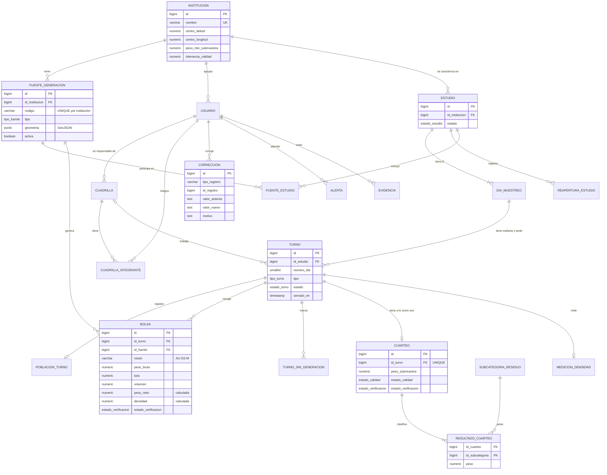

# Base de datos de EcoPoint Edu

La base de datos guarda en **PostgreSQL 16+** todo el dominio de caracterización de residuos: institución, fuentes de generación, estudios de 8 días, turnos, bolsas, cuarteos, densidades, el doble registro, las correcciones y las alertas. Se crea desde cero con dos scripts y se usa desde Java con repositorios JDBC (spec 002).

| Archivo | Para qué |
| --- | --- |
| [`sql/001_schema.sql`](../sql/001_schema.sql) | Crea tipos, tablas, restricciones, *trigger* y vistas. Se puede ejecutar varias veces. |
| [`sql/002_seed.sql`](../sql/002_seed.sql) | Carga los datos de demostración (siempre los mismos). |
| [`sql/recrear-base.ps1`](../sql/recrear-base.ps1), [`sql/recrear-base.sh`](../sql/recrear-base.sh) | Recrean la base con un solo comando. |

## 1. Diagrama de tablas y relaciones

## 2. Para qué sirve cada tabla

| Tabla | Clase Java | Qué guarda |
| --- | --- | --- |
| `INSTITUCION` | `Institution` | Colegio o universidad, centro del mapa y parámetros de caracterización (submuestra 45–55 kg, tolerancia del 2 %, límites de las bolsas) |
| `FUENTE_GENERACION` | `GenerationSource` | Aulas, oficinas, tienda, PAE, baños, zonas verdes, laboratorio… con su código y su polígono en el plano |
| `SUBCATEGORIA_RESIDUO` | `WasteCategory` | Catálogo de subcategorías (papel, cartón, pilas…) ligadas a los 4 grupos de la Res. 2184 de 2019 |
| `USUARIO` | `User` | Docentes y estudiantes universitarios, con su rol y el hash de su contraseña |
| `CUADRILLA`, `CUADRILLA_INTEGRANTE` | `Crew` | Cuadrillas de campo con su docente responsable |
| `ESTUDIO` | `CharacterizationStudy` | Estudio de caracterización y su estado |
| `DIA_MUESTREO` | `SamplingDay` | Los 8 días del estudio con su fecha |
| `REAPERTURA_ESTUDIO` | `StudyReopening` | Quién reabrió un estudio cerrado, cuándo y por qué |
| `FUENTE_ESTUDIO` | — | Fuentes que participan en cada estudio |
| `TURNO` | `SamplingShift` | Turnos de mañana y tarde, abiertos o cerrados |
| `TURNO_SIN_GENERACION` | — | Fuentes que no generaron residuos en un turno |
| `POBLACION_TURNO` | `ShiftPopulation` | Estudiantes, docentes y personal presentes en el turno |
| `BOLSA` | `WasteBag` | Cada bolsa con su rótulo, peso bruto, tara y volumen |
| `CUARTEO`, `RESULTADO_CUARTEO` | `Quartering`, `QuarteringResult` | Submuestra del turno y peso de cada subcategoría |
| `MEDICION_DENSIDAD` | `DensityMeasurement` | Peso y volumen del recipiente de medición |
| `CORRECCION` | `Correction` | Historial de correcciones del doble registro |
| `ALERTA` | `Alert` | Alertas de calidad del dato y su atención |
| `EVIDENCIA` | `Evidence` | Datos de las fotos de soporte |

Vistas:
- `V_TURNO_RESUMEN`: población, número de bolsas y kg netos por turno.
- `V_REGISTROS_PENDIENTES`: registros que faltan por verificar, por estudio.

## 3. Decisiones de diseño

| Decisión | Por qué |
| --- | --- |
| **Las reglas del dominio se repiten en la base** (`UNIQUE`, `CHECK`, `FOREIGN KEY`) | Es una segunda línea de defensa: aunque alguien escriba en la base sin pasar por la aplicación, no entran datos imposibles (tara mayor que el peso bruto, dos cuarteos en un turno, días fuera de 1–8…). |
| **Tipos `ENUM` de PostgreSQL** para las listas cerradas | Los valores son los mismos de los enums de Java (`SourceType`, `WasteGroup`, `StudyStatus`…), así que se leen con `Enum.valueOf` y la base rechaza cualquier valor desconocido. Las subcategorías sí son tabla, porque el catálogo puede crecer. |
| **Peso neto y densidad como columnas calculadas** (`GENERATED ALWAYS AS … STORED`) | Nunca se digitan, así que nunca contradicen el peso bruto, la tara y el volumen. |
| **Geometrías en `jsonb` con GeoJSON** | Es el formato que entiende el mapa web (MapLibre) y no exige instalar PostGIS. |
| **Correo y nombre de subcategoría únicos sin distinguir mayúsculas** (índices sobre `lower(...)`) | "Cartón" y " cartón " son la misma subcategoría; "Ana@UNICESAR" y "ana@unicesar" son el mismo correo. |
| **Historial de correcciones de solo inserción** (un *trigger* bloquea `UPDATE` y `DELETE`) | El valor original nunca se pierde: la trazabilidad del dato no depende de que la aplicación se porte bien. |
| **Columnas de verificación iguales** en las 4 tablas verificables | Población, bolsa, cuarteo y densidad se verifican igual, y la vista de pendientes las une. |
| **Políticas de borrado `RESTRICT` por defecto** | No se borra nada que tenga registros que dependen de él (una fuente con bolsas, una subcategoría con resultados…). Excepciones: `CASCADE` del cuarteo a sus resultados y de las tablas puente, y `SET NULL` de la cuadrilla en el turno. Cada política está comentada en el script. |
| **Transacciones** | Un cuarteo con sus resultados, una cuadrilla con sus integrantes y un estudio con sus días se guardan todo o nada (`@Transactional`). |
| **Contraseña fuera del repositorio** | La conexión se lee de `ECOPOINT_DB_URL`, `ECOPOINT_DB_USER` y `ECOPOINT_DB_PASSWORD`. |

## 4. Datos de demostración

`002_seed.sql` carga datos **ficticios pero realistas** para la I.E. Prudencia Daza:
- 15 subcategorías de los 4 grupos;
- 8 fuentes con polígonos provisionales;
- un docente y 4 estudiantes (contraseña de todos: `EcoPoint2026`);
- un estudio **cerrado** de 8 días con 16 turnos, con una corrección, una bolsa atípica y un cuarteo anulado;
- un estudio **en ejecución**, con un turno abierto y registros pendientes.

Los valores se calculan con fórmulas fijas, así que siempre se carga lo mismo.

## 5. Acceso desde Java

- Interfaces en `com.ecopoint.persistence` (`StudyRepository`, `ShiftRepository`…); los servicios dependen solo de ellas (Variaciones Protegidas).
- Implementaciones en `com.ecopoint.persistence.jdbc` con `NamedParameterJdbcTemplate`.
- Toda falla de la base llega como `PersistenceException`, sin mostrar SQL al usuario.
- Pruebas de integración (`*IT`) contra la base `ecopoint_test`, con `./mvnw verify`.
