# Class Diagram — EcoPoint Edu Core Architecture

This document presents the complete Unified Modeling Language (UML) class diagram for the core backend layers of **EcoPoint Edu** (`com.ecopoint.exceptions`, `com.ecopoint.model`, `com.ecopoint.validation`, and `com.ecopoint.service`).

## 1. Integrated UML Class Diagram

```mermaid
classDiagram
    direction TB

    %% ==========================================
    %% PACKAGE: com.ecopoint.exceptions
    %% ==========================================
    namespace com_ecopoint_exceptions {
        class EcoPointException {
            <<abstract>>
            -String errorCode
            #EcoPointException(String message)
            #EcoPointException(String message, String errorCode)
            #EcoPointException(String message, String errorCode, Throwable cause)
            +getErrorCode() String
        }

        class InvalidDataException {
            -String fieldName
            +InvalidDataException(String fieldName, String problemDescription)
            +InvalidDataException(String message)
            +getFieldName() String
        }

        class BusinessRuleException {
            +BusinessRuleException(String message)
            +BusinessRuleException(String message, String errorCode)
        }

        class ResourceNotFoundException {
            -String resourceType
            -Object resourceId
            +ResourceNotFoundException(String resourceType, Object resourceId)
            +getResourceType() String
            +getResourceId() Object
        }

        class PersistenceException {
            +PersistenceException(String operationContext, Throwable cause)
            +PersistenceException(String message)
        }
    }

    EcoPointException <|-- InvalidDataException
    EcoPointException <|-- BusinessRuleException
    EcoPointException <|-- ResourceNotFoundException
    EcoPointException <|-- PersistenceException

    %% ==========================================
    %% PACKAGE: com.ecopoint.model
    %% ==========================================
    namespace com_ecopoint_model {
        class Institution {
            -int idInstitution
            -String name
            -String address
            +Institution()
            +Institution(int idInstitution, String name, String address)
            +getIdInstitution() int
            +getName() String
            +getAddress() String
        }

        class Zone {
            -int idZone
            -int idInstitution
            -String name
            -String description
            +Zone()
            +Zone(int idZone, int idInstitution, String name, String description)
            +getIdZone() int
            +getIdInstitution() int
            +getName() String
        }

        class EcologicalPoint {
            -int idPoint
            -int idZone
            -String location
            -String status
            -String initialStatus
            -BigDecimal coordX
            -BigDecimal coordY
            -String observations
            -List~Container~ containers
            +EcologicalPoint()
            +addContainer(Container container) void
            +hasMandatoryThreeColors() boolean
        }

        class Container {
            -int idPoint
            -int idContainer
            -String wasteType
            -String color
            -BigDecimal capacity
            +Container()
            +isRegulatoryColor() boolean
        }

        class User {
            -int idUser
            -String firstName
            -String lastName
            -String email
            -String role
            +User()
            +getFullName() String
        }

        class InspectionDay {
            -int idDay
            -LocalDate date
            -String observations
            -List~InspectionRecord~ inspectionRecords
            +InspectionDay()
            +addInspectionRecord(InspectionRecord record) void
        }

        class InspectionRecord {
            -int idRecord
            -int idDay
            -int idPoint
            -int idUser
            -LocalDate captureDate
            -String pointStatus
            -String observations
            -List~ContainerDetail~ containerDetails
            -List~Evidence~ evidences
            -Quartering quartering
            +InspectionRecord()
            +addContainerDetail(ContainerDetail detail) void
            +addEvidence(Evidence evidence) void
            +hasCriticalIncidents() boolean
        }

        class ContainerDetail {
            -int idContainerDetail
            -int idRecord
            -int idPoint
            -int idContainer
            -String fillLevel
            -String containerCondition
            -String signageCondition
            -boolean improperSeparation
            -String observations
            +ContainerDetail()
            +requiresOverflowAlert() boolean
            +requiresImproperSeparationAlert() boolean
        }

        class Alert {
            -int idAlert
            -int idContainerDetail
            -String type
            -boolean attended
            -String description
            -LocalDateTime generatedAt
            +Alert()
            +markAsAttended() void
        }

        class Evidence {
            -int idEvidence
            -int idRecord
            -String filePath
            -String description
            -LocalDateTime uploadedAt
            +Evidence()
        }

        class WasteCategory {
            -int idWaste
            -String name
            -String description
            -String associatedColor
            +WasteCategory()
        }

        class Quartering {
            -int idQuartering
            -int idRecord
            -BigDecimal initialWeight
            -BigDecimal sampleWeight
            -String observations
            -List~QuarteringResult~ results
            +Quartering()
            +addResult(QuarteringResult result) void
            +calculateTotalClassifiedWeight() BigDecimal
            +calculateSampleLoss() BigDecimal
            +calculateCompositionPercentages() void
        }

        class QuarteringResult {
            -int idQuartering
            -int idResult
            -int idWaste
            -BigDecimal weight
            -int quantity
            -BigDecimal percentage
            +QuarteringResult()
            +calculatePercentageOver(BigDecimal sampleWeight) BigDecimal
        }
    }

    Institution "1" *-- "0..*" Zone : contains
    Zone "1" *-- "0..*" EcologicalPoint : locates
    EcologicalPoint "1" *-- "3" Container : has
    InspectionDay "1" *-- "0..*" InspectionRecord : includes
    EcologicalPoint "1" <-- "0..*" InspectionRecord : inspected-in
    User "1" <-- "0..*" InspectionRecord : captured-by
    InspectionRecord "1" *-- "3" ContainerDetail : evaluates
    Container "1" <-- "0..*" ContainerDetail : refers-to
    ContainerDetail "1" --> "0..*" Alert : triggers
    InspectionRecord "1" *-- "0..*" Evidence : attaches
    InspectionRecord "1" *-- "0..1" Quartering : originates
    Quartering "1" *-- "1..*" QuarteringResult : produces
    WasteCategory "1" <-- "0..*" QuarteringResult : classifies

    %% ==========================================
    %% PACKAGE: com.ecopoint.validation
    %% ==========================================
    namespace com_ecopoint_validation {
        class UserValidator {
            +validateUserData(User user)$ void
            +validatePersonName(String nameValue, String fieldName)$ void
            +validateEmailFormat(String email)$ void
            +validateInstitutionalRole(String role)$ void
            +validateUniqueEmail(String email, List~User~ existingUsers)$ void
            +validateUserExists(User user, Object identifier)$ void
        }

        class EcologicalPointValidator {
            +validateInstitutionData(Institution institution)$ void
            +validateZoneData(Zone zone, List~Zone~ existingZones)$ void
            +validateEcologicalPointData(EcologicalPoint point)$ void
            +validateCoordinates(BigDecimal coordX, BigDecimal coordY)$ void
            +validateRegulatoryContainers(List~Container~ containers)$ void
            +validatePointExists(EcologicalPoint point, int idPoint)$ void
        }

        class InspectionValidator {
            +validateInspectionDayData(InspectionDay day)$ void
            +validateInspectionRecordData(InspectionRecord record)$ void
            +validateContainerDetailData(ContainerDetail detail)$ void
            +validateEvidenceData(Evidence evidence)$ void
            +validateInspectionDayExists(InspectionDay day, int idDay)$ void
            +validateInspectionRecordExists(InspectionRecord record, int idRecord)$ void
        }

        class QuarteringValidator {
            +validateQuarteringData(Quartering quartering)$ void
            +validateWeightCoherence(Quartering quartering)$ void
            +validateUniqueQuarteringPerRecord(int idRecord, List~Quartering~ existingQuarterings)$ void
            +validateQuarteringExists(Quartering quartering, int idQuartering)$ void
        }
    }

    %% ==========================================
    %% PACKAGE: com.ecopoint.service
    %% ==========================================
    namespace com_ecopoint_service {
        class UserService {
            -List~User~ users
            -int nextId
            +registerUser(User user) User
            +getUserById(int idUser) User
            +getUserByEmail(String email) User
            +listAllUsers() List~User~
        }

        class EcologicalPointService {
            -List~Institution~ institutions
            -List~Zone~ zones
            -List~EcologicalPoint~ points
            +registerInstitution(Institution institution) Institution
            +registerZone(Zone zone) Zone
            +registerEcologicalPoint(EcologicalPoint point) EcologicalPoint
            +updatePointCoordinatesAndStatus(int idPoint, BigDecimal coordX, BigDecimal coordY, String newStatus) EcologicalPoint
            +getEcologicalPointById(int idPoint) EcologicalPoint
            +listPointsByZone(Integer idZone) List~EcologicalPoint~
        }

        class AlertService {
            -List~Alert~ alerts
            -int nextAlertId
            +evaluateAndGenerateAutomaticAlerts(InspectionRecord record) List~Alert~
            +markAlertAsAttended(int idAlert) Alert
            +getAlertById(int idAlert) Alert
            +listPendingAlerts() List~Alert~
        }

        class InspectionService {
            -EcologicalPointService pointService
            -UserService userService
            -AlertService alertService
            +createInspectionDay(InspectionDay day) InspectionDay
            +registerPointInspection(InspectionRecord record) InspectionRecord
            +getInspectionDayById(int idDay) InspectionDay
            +getInspectionRecordById(int idRecord) InspectionRecord
            +listInspectionDays() List~InspectionDay~
        }

        class QuarteringService {
            -InspectionService inspectionService
            -List~Quartering~ quarterings
            +registerQuartering(Quartering quartering) Quartering
            +getQuarteringById(int idQuartering) Quartering
            +listAllQuarterings() List~Quartering~
        }
    }

    UserService --> UserValidator : delegates validation
    EcologicalPointService --> EcologicalPointValidator : delegates validation
    InspectionService --> InspectionValidator : delegates validation
    InspectionService --> AlertService : triggers alerts
    InspectionService --> EcologicalPointService : verifies point
    InspectionService --> UserService : verifies user
    QuarteringService --> QuarteringValidator : delegates validation
    QuarteringService --> InspectionService : verifies record

    UserValidator ..> EcoPointException : throws
    EcologicalPointValidator ..> EcoPointException : throws
    InspectionValidator ..> EcoPointException : throws
    QuarteringValidator ..> EcoPointException : throws
```

---

## 2. GRASP and SOLID Principles Traceability

| Pattern / Principle | Category | Applied Classes | Architectural Justification |
| :--- | :---: | :--- | :--- |
| **Information Expert** | GRASP | `Quartering`, `QuarteringResult`, `ContainerDetail`, `EcologicalPoint`, `User` | Each domain entity computes values derived directly from its own attributes (`calculateCompositionPercentages()`, `requiresOverflowAlert()`, `hasMandatoryThreeColors()`, `getFullName()`). |
| **Creator** | GRASP | `EcologicalPoint`, `InspectionRecord`, `AlertService` | `EcologicalPoint` aggregates `Container` instances; `InspectionRecord` aggregates `ContainerDetail` and `Evidence`; `AlertService` instantiates `Alert` objects from inspection evaluations. |
| **Pure Fabrication** | GRASP | `UserValidator`, `EcologicalPointValidator`, `InspectionValidator`, `QuarteringValidator` | Stateless validation classes fabricated to avoid overloading domain entities or business services with raw input parsing and regulatory checks. |
| **Low Coupling & High Cohesion** | GRASP | `UserService`, `EcologicalPointService`, `InspectionService`, `QuarteringService` | Services focus strictly on business orchestration while delegating validation rules to dedicated validators and communicating errors via unchecked `EcoPointException` subclasses. |
| **Single Responsibility Principle (SRP)** | SOLID | `*Validator` vs `*Service` vs `model.*` | Domain models only change when business state/calculations change; validators only change when validation rules change; services only change when use-case workflows change. |
| **Open/Closed (OCP) & Liskov Substitution (LSP)** | SOLID | `EcoPointException` hierarchy | New domain error types can be added as subclasses without modifying `EcoPointException`, and all subclasses honor the base contract (`getErrorCode()`, `getMessage()`). |
