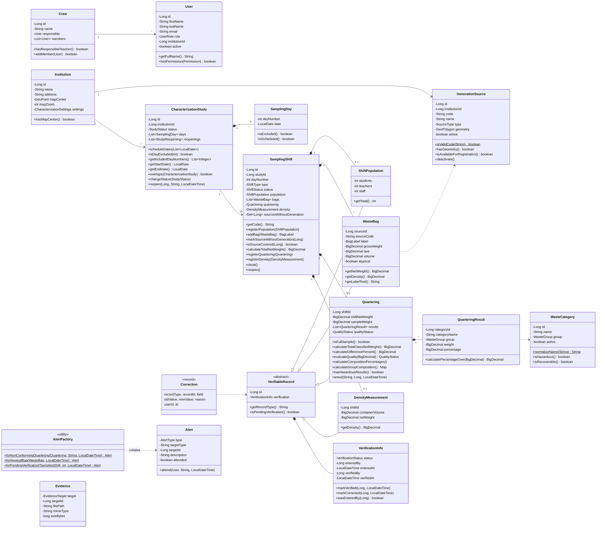
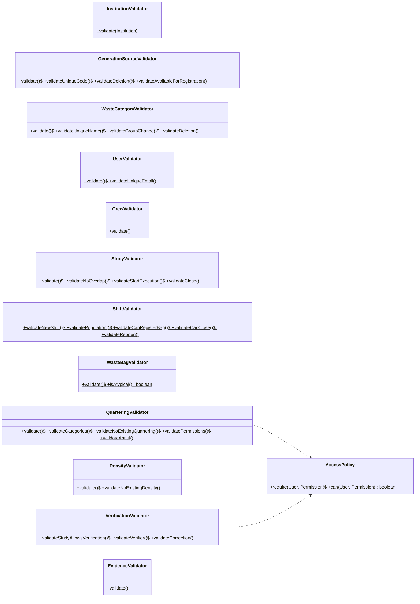

# Class Diagram — EcoPoint Edu Domain (spec 001)

This document presents the UML class diagram of the **solid waste characterization domain** of EcoPoint Edu, built in spec 001: the domain model (`com.ecopoint.model`), the stateless validators (`com.ecopoint.validation`) and the exception hierarchy (`com.ecopoint.exceptions`).

Persistence (spec 002), REST API (spec 003) and web screens (specs 004 to 007) are not part of this diagram yet.

> The previous model (ecological points, Swing UI and flat files) is kept in the git tag `v1-modelo-anterior`.

## 1. Domain model

### Value objects and enums

| Type | Kind | Purpose |
| --- | --- | --- |
| `GeoPoint`, `GeoPolygon` | record | WGS84 coordinates and closed polygons of the sources (RN-004) |
| `BagLabel` | record | Bag label `AU-D3-M`, `AU-D3-M-2` (RN-031) |
| `CharacterizationSettings` | record | Sample range 45–55 kg, 2 % tolerance, bag plausibility limits (D8, RN-037) |
| `StudyReopening` | record | Who reopened a closed study, why and when (RN-017) |
| `WasteGroup` | enum | BLANCO, VERDE, NEGRO, SIN_COLOR (Res. 2184 de 2019) |
| `StudyStatus` | enum | PLANIFICADO → EN_EJECUCION → EN_DEPURACION → CERRADO |
| `UserRole`, `Permission` | enum | DOCENTE and ESTUDIANTE_UNIVERSITARIO; permission matrix RN-081 |
| `SourceType`, `ShiftType`, `ShiftStatus`, `VerificationStatus`, `QualityStatus`, `AlertType`, `EvidenceTarget` | enum | Closed lists of the domain |

## 2. Validators

All validators are `final`, stateless classes with a private constructor and `static` methods. Data about other objects (existing codes, other studies, participating sources) is received as parameters, because the domain does not query the database.

## 3. GRASP and SOLID traceability

| Principle | Where | Why |
| --- | --- | --- |
| **Information Expert** | `WasteBag.getNetWeight()`, `Quartering.evaluateQuality()`, `SamplingShift.calculateTotalNetWeight()`, `CharacterizationStudy.overlaps()` | Each calculation lives in the class that owns the data |
| **Creator** | `SamplingShift.addBag()` assigns the `BagLabel`; `AlertFactory` creates `Alert` | The aggregate that contains or records the object creates it |
| **Pure Fabrication** | All `*Validator` classes and `AccessPolicy` | Validation rules do not belong to any single entity |
| **Low Coupling** | `model` imports only `exceptions`; `validation` imports only `model` and `exceptions` | Layers can change and be tested in isolation |
| **High Cohesion** | One validator per aggregate (study, shift, bag, quartering…) | Each class has one focused job |
| **Polymorphism** | `VerifiableRecord` (abstract) with `ShiftPopulation`, `WasteBag`, `Quartering`, `DensityMeasurement` | The verification inbox treats every record the same way |
| **SRP** | `VerificationInfo` only handles double registration; `CharacterizationSettings` only holds parameters | One reason to change per class |
| **OCP** | New verifiable records extend `VerifiableRecord`; new permissions are added to `Permission` and `UserRole` | Behavior is extended without modifying existing classes |
| **LSP** | Any `VerifiableRecord` subclass can replace the base type in `VerificationValidator` | Subclasses keep the base contract |
| **DIP** | Services (specs 002–003) will depend on repository interfaces | High-level policy does not depend on storage details |
