# Class Diagram — EcoPoint Edu Architecture

This document presents the Unified Modeling Language (UML) class diagram for **EcoPoint Edu**, integrating the Domain Model (`com.ecopoint.model`), Custom Exceptions (`com.ecopoint.exceptions`), Stateless Validators (`com.ecopoint.validation`), Protected Variations Persistence (`com.ecopoint.persistence`), Business Services (`com.ecopoint.service`), and Java Swing User Interface (`com.ecopoint.ui`).

## 1. Integrated UML Class Diagram

```mermaid
classDiagram
    direction TB

    %% ==========================================
    %% PACKAGE: com.ecopoint.exceptions
    %% ==========================================
    namespace com_ecopoint_exceptions {
        class EcoPointException {
            <<abstract>>
            -String errorCode
            #EcoPointException(String message)
            #EcoPointException(String message, String errorCode)
            #EcoPointException(String message, String errorCode, Throwable cause)
            +getErrorCode() String
        }

        class InvalidDataException {
            -String fieldName
            +InvalidDataException(String fieldName, String problemDescription)
            +InvalidDataException(String message)
            +getFieldName() String
        }

        class BusinessRuleException {
            +BusinessRuleException(String message)
            +BusinessRuleException(String message, String errorCode)
        }

        class ResourceNotFoundException {
            -String resourceType
            -Object resourceId
            +ResourceNotFoundException(String resourceType, Object resourceId)
            +getResourceType() String
            +getResourceId() Object
        }

        class PersistenceException {
            +PersistenceException(String operationContext, Throwable cause)
            +PersistenceException(String message)
        }
    }

    EcoPointException <|-- InvalidDataException
    EcoPointException <|-- BusinessRuleException
    EcoPointException <|-- ResourceNotFoundException
    EcoPointException <|-- PersistenceException

    %% ==========================================
    %% PACKAGE: com.ecopoint.model
    %% ==========================================
    namespace com_ecopoint_model {
        class Institution {
            -int idInstitution
            -String name
            -String address
        }

        class Zone {
            -int idZone
            -int idInstitution
            -String name
            -String description
        }

        class EcologicalPoint {
            -int idPoint
            -int idZone
            -String location
            -String status
            -String initialStatus
            -BigDecimal coordX
            -BigDecimal coordY
            -String observations
            -List~Container~ containers
            +addContainer(Container container) void
            +hasMandatoryThreeColors() boolean
        }

        class Container {
            -int idPoint
            -int idContainer
            -String wasteType
            -String color
            -BigDecimal capacity
            +isRegulatoryColor() boolean
        }

        class User {
            -int idUser
            -String firstName
            -String lastName
            -String email
            -String role
            +getFullName() String
        }

        class InspectionDay {
            -int idDay
            -LocalDate date
            -String observations
            -List~InspectionRecord~ inspectionRecords
            +addInspectionRecord(InspectionRecord record) void
        }

        class InspectionRecord {
            -int idRecord
            -int idDay
            -int idPoint
            -int idUser
            -LocalDate captureDate
            -String pointStatus
            -String observations
            -List~ContainerDetail~ containerDetails
            -List~Evidence~ evidences
            -Quartering quartering
            +hasCriticalIncidents() boolean
        }

        class ContainerDetail {
            -int idContainerDetail
            -int idRecord
            -int idPoint
            -int idContainer
            -String fillLevel
            -String containerCondition
            -String signageCondition
            -boolean improperSeparation
            -String observations
            +requiresOverflowAlert() boolean
            +requiresImproperSeparationAlert() boolean
        }

        class Alert {
            -int idAlert
            -int idContainerDetail
            -String type
            -boolean attended
            -String description
            -LocalDateTime generatedAt
            +markAsAttended() void
        }

        class Evidence {
            -int idEvidence
            -int idRecord
            -String filePath
            -String description
            -LocalDateTime uploadedAt
        }

        class WasteCategory {
            -int idWaste
            -String name
            -String description
            -String associatedColor
        }

        class Quartering {
            -int idQuartering
            -int idRecord
            -BigDecimal initialWeight
            -BigDecimal sampleWeight
            -String observations
            -List~QuarteringResult~ results
            +calculateTotalClassifiedWeight() BigDecimal
            +calculateSampleLoss() BigDecimal
            +calculateCompositionPercentages() void
        }

        class QuarteringResult {
            -int idQuartering
            -int idResult
            -int idWaste
            -BigDecimal weight
            -int quantity
            -BigDecimal percentage
            +calculatePercentageOver(BigDecimal sampleWeight) BigDecimal
        }
    }

    Institution "1" *-- "0..*" Zone : contains
    Zone "1" *-- "0..*" EcologicalPoint : locates
    EcologicalPoint "1" *-- "3" Container : has
    InspectionDay "1" *-- "0..*" InspectionRecord : includes
    EcologicalPoint "1" <-- "0..*" InspectionRecord : inspected-in
    User "1" <-- "0..*" InspectionRecord : captured-by
    InspectionRecord "1" *-- "3" ContainerDetail : evaluates
    ContainerDetail "1" --> "0..*" Alert : triggers
    InspectionRecord "1" *-- "0..*" Evidence : attaches
    InspectionRecord "1" *-- "0..1" Quartering : originates
    Quartering "1" *-- "1..*" QuarteringResult : produces
    WasteCategory "1" <-- "0..*" QuarteringResult : classifies

    %% ==========================================
    %% PACKAGE: com.ecopoint.persistence
    %% ==========================================
    namespace com_ecopoint_persistence {
        class UserRepository {
            <<interface>>
            +save(User user) User
            +findById(int idUser) User
            +findByEmail(String email) User
            +findAll() List~User~
            +deleteById(int idUser) boolean
        }

        class InstitutionRepository {
            <<interface>>
            +save(Institution institution) Institution
            +findById(int idInstitution) Institution
            +findAll() List~Institution~
            +deleteById(int idInstitution) boolean
        }

        class ZoneRepository {
            <<interface>>
            +save(Zone zone) Zone
            +findById(int idZone) Zone
            +findAll() List~Zone~
            +deleteById(int idZone) boolean
        }

        class EcologicalPointRepository {
            <<interface>>
            +save(EcologicalPoint point) EcologicalPoint
            +findById(int idPoint) EcologicalPoint
            +findAll() List~EcologicalPoint~
            +deleteById(int idPoint) boolean
        }

        class InspectionRepository {
            <<interface>>
            +saveDay(InspectionDay day) InspectionDay
            +findDayById(int idDay) InspectionDay
            +findAllDays() List~InspectionDay~
            +saveRecord(InspectionRecord record) InspectionRecord
            +findRecordById(int idRecord) InspectionRecord
            +findAllRecords() List~InspectionRecord~
        }

        class QuarteringRepository {
            <<interface>>
            +save(Quartering quartering) Quartering
            +findById(int idQuartering) Quartering
            +findAll() List~Quartering~
            +deleteById(int idQuartering) boolean
        }

        class AlertRepository {
            <<interface>>
            +save(Alert alert) Alert
            +findById(int idAlert) Alert
            +findAll() List~Alert~
            +deleteById(int idAlert) boolean
        }

        class FileUserRepository
        class FileInstitutionRepository
        class FileZoneRepository
        class FileEcologicalPointRepository
        class FileInspectionRepository
        class FileQuarteringRepository
        class FileAlertRepository
    }

    UserRepository <|.. FileUserRepository
    InstitutionRepository <|.. FileInstitutionRepository
    ZoneRepository <|.. FileZoneRepository
    EcologicalPointRepository <|.. FileEcologicalPointRepository
    InspectionRepository <|.. FileInspectionRepository
    QuarteringRepository <|.. FileQuarteringRepository
    AlertRepository <|.. FileAlertRepository

    %% ==========================================
    %% PACKAGE: com.ecopoint.validation
    %% ==========================================
    namespace com_ecopoint_validation {
        class UserValidator {
            +validateUserData(User user)$ void
            +validateUniqueEmail(String email, List~User~ existingUsers)$ void
            +validateUniqueEmailForUpdate(int currentUserId, String email, List~User~ existingUsers)$ void
        }

        class EcologicalPointValidator {
            +validateInstitutionData(Institution institution)$ void
            +validateZoneData(Zone zone, List~Zone~ existingZones)$ void
            +validateEcologicalPointData(EcologicalPoint point)$ void
            +validateCoordinates(BigDecimal coordX, BigDecimal coordY)$ void
            +validateRegulatoryContainers(List~Container~ containers)$ void
        }

        class InspectionValidator {
            +validateInspectionDayData(InspectionDay day)$ void
            +validateInspectionRecordData(InspectionRecord record)$ void
        }

        class QuarteringValidator {
            +validateQuarteringData(Quartering quartering)$ void
            +validateWeightCoherence(Quartering quartering)$ void
            +validateUniqueQuarteringPerRecord(int idRecord, List~Quartering~ existingQuarterings)$ void
        }
    }

    %% ==========================================
    %% PACKAGE: com.ecopoint.service
    %% ==========================================
    namespace com_ecopoint_service {
        class UserService {
            -UserRepository userRepository
            +authenticateByEmail(String email) User
            +registerUser(User user) User
            +updateUser(User user) User
            +deleteUser(int idUser) void
            +listAllUsers() List~User~
        }

        class EcologicalPointService {
            -InstitutionRepository institutionRepository
            -ZoneRepository zoneRepository
            -EcologicalPointRepository pointRepository
            +registerInstitution(Institution institution) Institution
            +registerZone(Zone zone) Zone
            +registerEcologicalPoint(EcologicalPoint point) EcologicalPoint
            +updateEcologicalPoint(EcologicalPoint point) EcologicalPoint
            +deleteEcologicalPoint(int idPoint) void
        }

        class AlertService {
            -AlertRepository alertRepository
            +evaluateAndGenerateAutomaticAlerts(InspectionRecord record) List~Alert~
            +markAlertAsAttended(int idAlert) Alert
            +listPendingAlerts() List~Alert~
        }

        class InspectionService {
            -EcologicalPointService pointService
            -UserService userService
            -AlertService alertService
            -InspectionRepository inspectionRepository
            +createInspectionDay(InspectionDay day) InspectionDay
            +registerPointInspection(InspectionRecord record) InspectionRecord
        }

        class QuarteringService {
            -InspectionService inspectionService
            -QuarteringRepository quarteringRepository
            +registerQuartering(Quartering quartering) Quartering
            +calculateConsolidatedStatistics() Map~String, BigDecimal~
        }
    }

    %% ==========================================
    %% PACKAGE: com.ecopoint.ui
    %% ==========================================
    namespace com_ecopoint_ui {
        class LoginFrame
        class MainFrame
        class DashboardAndAlertsPanel
        class CampusAndPointPanel
        class InspectionManagementPanel
        class QuarteringManagementPanel
        class UserManagementPanel
    }

    LoginFrame --> MainFrame : launches
    MainFrame *-- DashboardAndAlertsPanel
    MainFrame *-- CampusAndPointPanel
    MainFrame *-- InspectionManagementPanel
    MainFrame *-- QuarteringManagementPanel
    MainFrame *-- UserManagementPanel

    UserService --> UserRepository : Protected Variations
    EcologicalPointService --> InstitutionRepository : Protected Variations
    EcologicalPointService --> ZoneRepository : Protected Variations
    EcologicalPointService --> EcologicalPointRepository : Protected Variations
    InspectionService --> InspectionRepository : Protected Variations
    QuarteringService --> QuarteringRepository : Protected Variations
    AlertService --> AlertRepository : Protected Variations

    UserService --> UserValidator : delegates
    EcologicalPointService --> EcologicalPointValidator : delegates
    InspectionService --> InspectionValidator : delegates
    QuarteringService --> QuarteringValidator : delegates
```

---

## 2. GRASP and SOLID Principles Traceability

| Pattern / Principle | Category | Applied Classes | Architectural Justification |
| :--- | :---: | :--- | :--- |
| **Protected Variations & Dependency Inversion (DIP)** | GRASP / SOLID | `UserRepository`, `EcologicalPointRepository`, `InspectionRepository`, `QuarteringRepository`, `AlertRepository` and `File*Repository` | Services depend exclusively on repository interfaces (`*Repository`), isolating the business logic and Swing UI from the underlying flat-file storage (`data/*.txt`) and enabling zero-impact migration to a relational database. |
| **Information Expert** | GRASP | `Quartering`, `QuarteringResult`, `ContainerDetail`, `EcologicalPoint`, `User` | Domain models compute derived metrics directly from their encapsulated state (`calculateCompositionPercentages()`, `requiresOverflowAlert()`, `hasMandatoryThreeColors()`). |
| **Pure Fabrication & Single Responsibility (SRP)** | GRASP / SOLID | `*Validator`, `FileStorageHelper`, `File*Repository` | Validation rules and flat-file I/O operations are extracted into dedicated classes so domain entities and services remain cohesive. |
| **Open/Closed (OCP) & Liskov Substitution (LSP)** | SOLID | `EcoPointException` hierarchy & `*Repository` implementations | Any repository implementation (`File*Repository` or future `Jdbc*Repository`) and any `EcoPointException` subclass can be substituted transparently without altering client contracts. |
