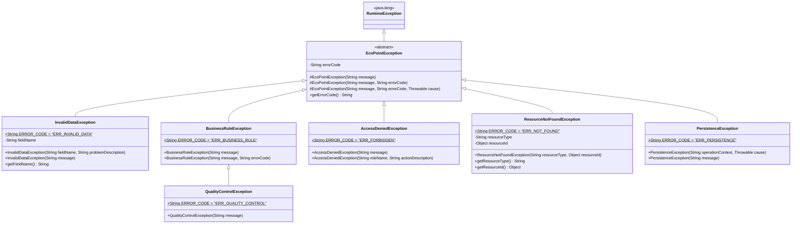

# Exception Hierarchy Diagram — EcoPoint Edu

This document details the custom exception hierarchy of the `com.ecopoint.exceptions` package. Every rejection of a domain rule throws one of these exceptions with a message in Spanish (CA-090); the REST layer (spec 003) translates each one into an HTTP status.

## 1. Exception inheritance hierarchy

---

## 2. Classification and trigger matrix

| Exception | Error code | HTTP (spec 003) | Examples in the characterization domain |
| :--- | :---: | :---: | :--- |
| **`InvalidDataException`** | `ERR_INVALID_DATA` | 400 | Source code `au` or `AULAS12` (CA-001); tare greater than gross weight (CA-031); population of zero people (CA-021); weights with more than 2 decimals; latitude 95 (CA-003); photo larger than 5 MB (RN-090) |
| **`BusinessRuleException`** | `ERR_BUSINESS_RULE` | 422 | Duplicated source code (CA-002); bag without shift population (CA-022); study skipping a status (CA-013); sample outside 45–55 kg (CA-050); verifying a record you typed (CA-060); deleting a source with bags (RN-005) |
| **`QualityControlException`** | `ERR_QUALITY_CONTROL` | 422 | Closing a study with a non-conforming quartering still unresolved (RN-016) |
| **`AccessDeniedException`** | `ERR_FORBIDDEN` | 403 | A university student trying to open or close a shift (CA-204) or to create a study (CA-203); an inactive user |
| **`ResourceNotFoundException`** | `ERR_NOT_FOUND` | 404 | Thrown by the service layer when a study, shift, bag or user id does not exist |
| **`PersistenceException`** | `ERR_PERSISTENCE` | 500 | Database failures in the persistence layer (spec 002); the user only sees a generic message |

The non-conforming quartering itself is **not** an exception: it is saved with status `NO_CONFORME` and raises an alert, so the crew can re-weigh (RN-052, RN-070).
