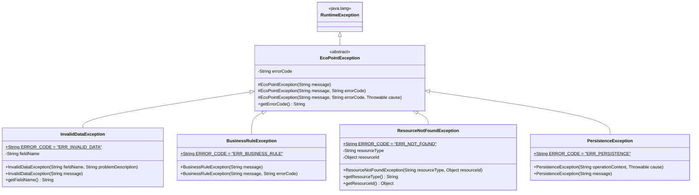

# Exception Hierarchy Diagram — EcoPoint Edu

This document details the custom exception hierarchy implemented in the `com.ecopoint.exceptions` package.

## 1. Exception Inheritance Hierarchy

---

## 2. Exception Classification and Trigger Matrix

| Exception Class | Error Code | Primary Trigger Scenarios in EcoPoint Edu |
| :--- | :---: | :--- |
| **`InvalidDataException`** | `ERR_INVALID_DATA` | • Required fields are `null` or blank. • User `firstName`, `lastName`, or `role` contains numbers or special symbols. • User `email` is missing the `@` symbol or has an invalid domain. • Map coordinates (`coordX`, `coordY`) are outside `[0.00, 100.00]`. • Container capacity or quartering weights are $\le 0$. • Inspection fill level is not in `{VACIO, BAJO, MEDIO, ALTO, DESBORDADO}`. • Evidence file path does not end in `.jpg`, `.jpeg`, `.png`, or `.webp`. |
| **`BusinessRuleException`** | `ERR_BUSINESS_RULE` | • Attempting to register a `User` with an email address that already exists. • Attempting to register a duplicate `Zone` name inside the same `Institution`. • Registering an `EcologicalPoint` without the exact 3 containers required by Resolution 2184 of 2019 (`BLANCO`, `VERDE`, `NEGRO`). • Submitting a `Quartering` where `sampleWeight > initialWeight`. • Submitting a `Quartering` where the sum of classified weights exceeds `sampleWeight`. • Attempting to register more than one `Quartering` for the same `InspectionRecord`. • Attempting to mark an already attended `Alert` as attended again. |
| **`ResourceNotFoundException`** | `ERR_NOT_FOUND` | • Searching for a `User`, `Institution`, `Zone`, `EcologicalPoint`, `InspectionDay`, `InspectionRecord`, `Quartering`, or `Alert` by an ID or email that does not exist. |
| **`PersistenceException`** | `ERR_PERSISTENCE` | • Failures occurring during data storage or retrieval operations. |
