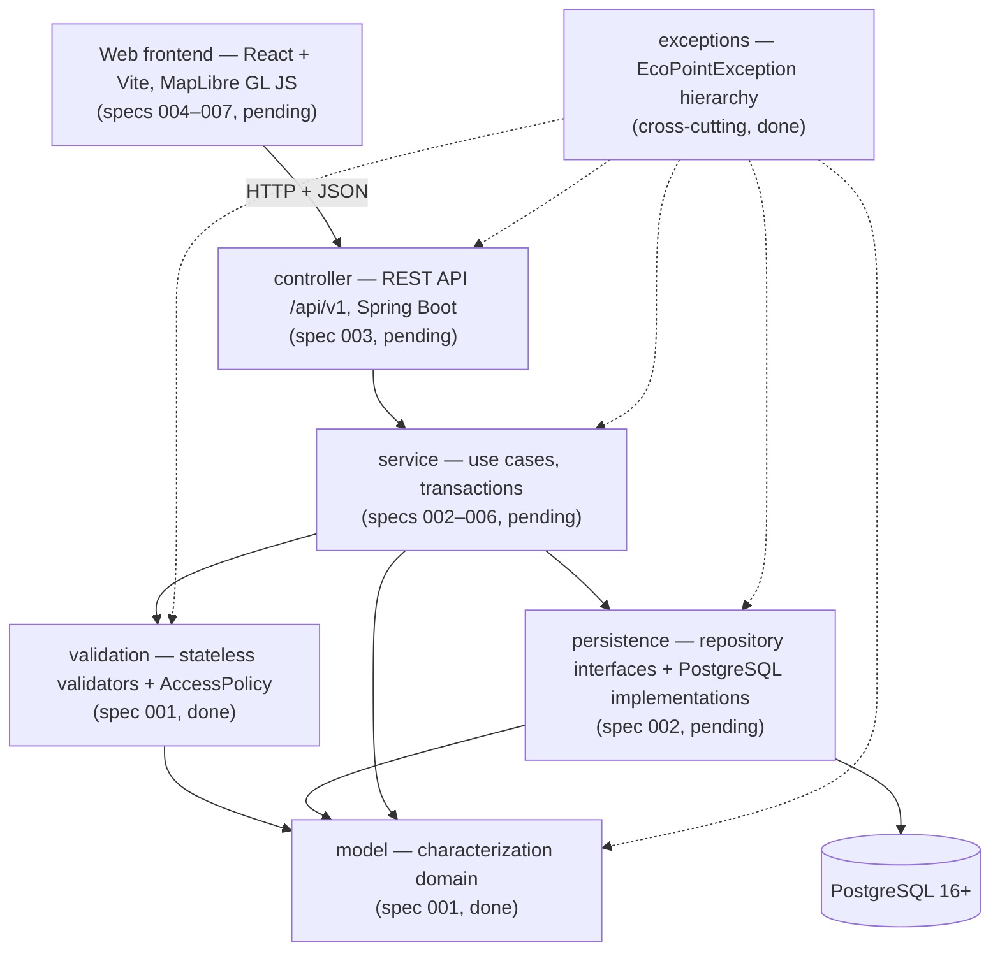

# Layered Architecture Diagram — EcoPoint Edu

This document describes the target layered architecture of **EcoPoint Edu** after the restructuring, and which layers already exist. The full rules are in [`AGENTS.md`](../AGENTS.md).

## 1. Layers and dependency direction

## 2. Dependency rules

| Package | May import | Must not import |
| --- | --- | --- |
| `model` | `exceptions` | `validation`, `service`, `persistence`, `controller` |
| `validation` | `model`, `exceptions` | `service`, `persistence`, `controller` |
| `persistence` | `model`, `exceptions` | `service`, `controller` |
| `service` | `validation`, `model`, `persistence` (interfaces only), `exceptions` | `controller`, persistence implementations |
| `controller` | `service`, DTOs, `exceptions` | `persistence`, business rules |

## 3. Why this structure

* **Low Coupling and Protected Variations:** services depend on repository interfaces, so changing the database does not touch the business rules.
* **Pure Fabrication:** validators hold the rules that do not belong to a single entity and need data from several objects, received as parameters.
* **Information Expert:** calculations (net weight, density, composition, 2 % control) live in the domain classes that own the data.
* **Testability:** the domain and the validators are plain Java and are tested without a database, a server or a browser.
