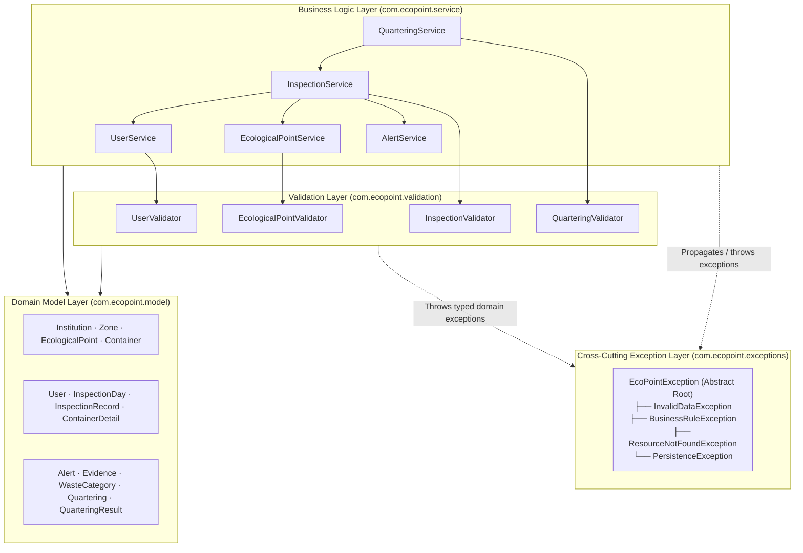

# Layered Architecture Diagram — EcoPoint Edu

This document describes the layered architecture of the **EcoPoint Edu** backend core, illustrating package responsibilities and unidirectional dependency flow.

## 1. Package Dependency and Layer Diagram

---

## 2. Layer Responsibilities and Dependency Rules

| Layer | Package | Core Responsibility | Allowed Dependencies |
| :--- | :--- | :--- | :--- |
| **Business Service Layer** | `com.ecopoint.service` | Coordinates domain use cases, invokes validators before state mutation, triggers automatic alerts, and executes quartering composition calculations. | `com.ecopoint.validation`, `com.ecopoint.model`, `com.ecopoint.exceptions` |
| **Validation Layer** | `com.ecopoint.validation` | Stateless precondition gates verifying syntactic format (e.g., no numbers in names, valid `@` email format, coordinate ranges) and domain invariants (e.g., unique email, 3 mandatory container colors, quartering weight coherence). | `com.ecopoint.model`, `com.ecopoint.exceptions` |
| **Domain Model Layer** | `com.ecopoint.model` | Encapsulates domain entities with private attributes, constructors, getters/setters, and Information Expert methods. | Standard Java API (`java.math`, `java.time`, `java.util`) |
| **Cross-Cutting Exceptions** | `com.ecopoint.exceptions` | Provides the unchecked exception hierarchy rooted in `EcoPointException` carrying user-facing messages in Spanish and semantic error codes. | Standard Java API (`java.lang.RuntimeException`) |
