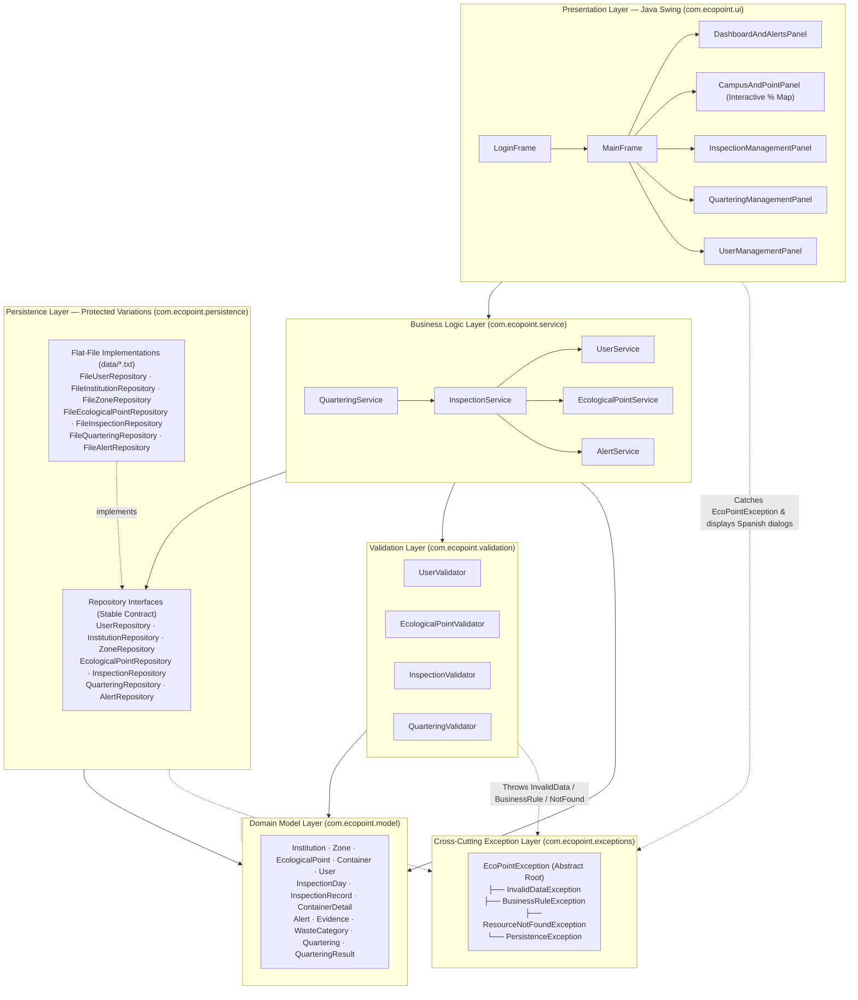

# Layered Architecture Diagram — EcoPoint Edu

This document describes the layered architecture of **EcoPoint Edu**, including the Java Swing Presentation Layer (`com.ecopoint.ui`), Business Service Layer (`com.ecopoint.service`), Validation Layer (`com.ecopoint.validation`), Protected Variations Persistence Layer (`com.ecopoint.persistence`), Domain Model Layer (`com.ecopoint.model`), and Cross-Cutting Exception Layer (`com.ecopoint.exceptions`).

## 1. Package Dependency and Layer Diagram

---

## 2. Layer Responsibilities and Protected Variations

| Layer | Package | Core Responsibility |
| :--- | :--- | :--- |
| **Presentation Layer** | `com.ecopoint.ui` | Java Swing graphical interface applying the official EcoPoint Edu logo color palette. Provides session login, full CRUD forms, interactive percentage map, quartering calculator, and dashboard statistics. |
| **Business Service Layer** | `com.ecopoint.service` | Orchestrates domain use cases, delegates precondition checks to validators, triggers automatic alerts, computes consolidated statistics, and persists changes through `*Repository` interfaces. |
| **Validation Layer** | `com.ecopoint.validation` | Stateless precondition gates verifying syntactic format and domain rules (Resolution 2184 of 2019 3-color rule, unique user emails, quartering weight coherence). |
| **Persistence Layer** | `com.ecopoint.persistence` | Applies **Protected Variations** and **Dependency Inversion (DIP)** via `*Repository` interfaces. Currently implemented over UTF-8 flat files (`data/*.txt`) and ready for seamless database migration. |
| **Domain Model Layer** | `com.ecopoint.model` | Encapsulates the 13 domain entities and their Information Expert calculations. |
| **Cross-Cutting Exceptions** | `com.ecopoint.exceptions` | Unchecked exception hierarchy rooted in `EcoPointException` carrying user-facing Spanish error messages. |
