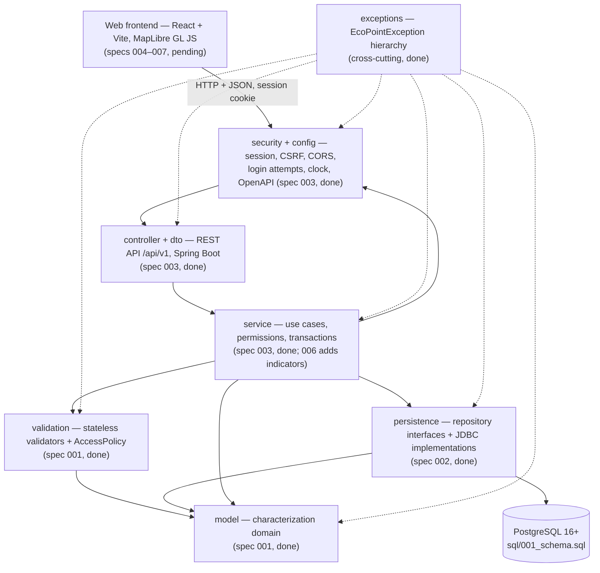

# Layered Architecture Diagram — EcoPoint Edu

This document describes the target layered architecture of **EcoPoint Edu** after the restructuring, and which layers already exist. The full rules are in [`AGENTS.md`](../AGENTS.md).

## 1. Layers and dependency direction

## 2. Dependency rules

| Package | May import | Must not import |
| --- | --- | --- |
| `model` | `exceptions` | `validation`, `service`, `persistence`, `controller` |
| `validation` | `model`, `exceptions` | `service`, `persistence`, `controller` |
| `persistence` | `model`, `exceptions` | `service`, `controller` |
| `service` | `validation`, `model`, `persistence` (interfaces only), `exceptions` | `controller`, persistence implementations |
| `service` (only `AuthService`) | `security.LoginAttemptService` | other `security` classes |
| `dto` | `model`, read models of `service` (`SourceProgress`, `ShiftSlot`) | `persistence`, `controller` |
| `controller` | `service`, `dto`, `security.EcoPointUserDetails`, `exceptions` | `persistence`, `validation`, business rules |
| `security`, `config` | `model`, `dto`, `persistence` interfaces, `exceptions` | `controller` |

## 3. Why this structure

* **Low Coupling and Protected Variations:** services depend on repository interfaces, so changing the database does not touch the business rules.
* **Pure Fabrication:** validators hold the rules that do not belong to a single entity and need data from several objects, received as parameters.
* **Information Expert:** calculations (net weight, density, composition, 2 % control) live in the domain classes that own the data.
* **Testability:** the domain and the validators are plain Java and are tested without a database, a server or a browser.

## 4. How a request flows (spec 003)

1. The security filters check the session cookie (401 if missing), the CSRF header on writes (403 if missing) and the origin (CORS).
2. The controller reads the JSON into a request DTO and asks `CurrentUser` for the user of the session, reloaded from the database.
3. The service checks the permission with `AccessPolicy` (RN-081), validates with the validators, applies the domain methods and saves through the repository interfaces, inside a transaction when it writes several tables.
4. The controller turns the result into a response DTO. Any `EcoPointException` becomes the error JSON of R-110 in `ApiExceptionHandler`, with its HTTP status.
