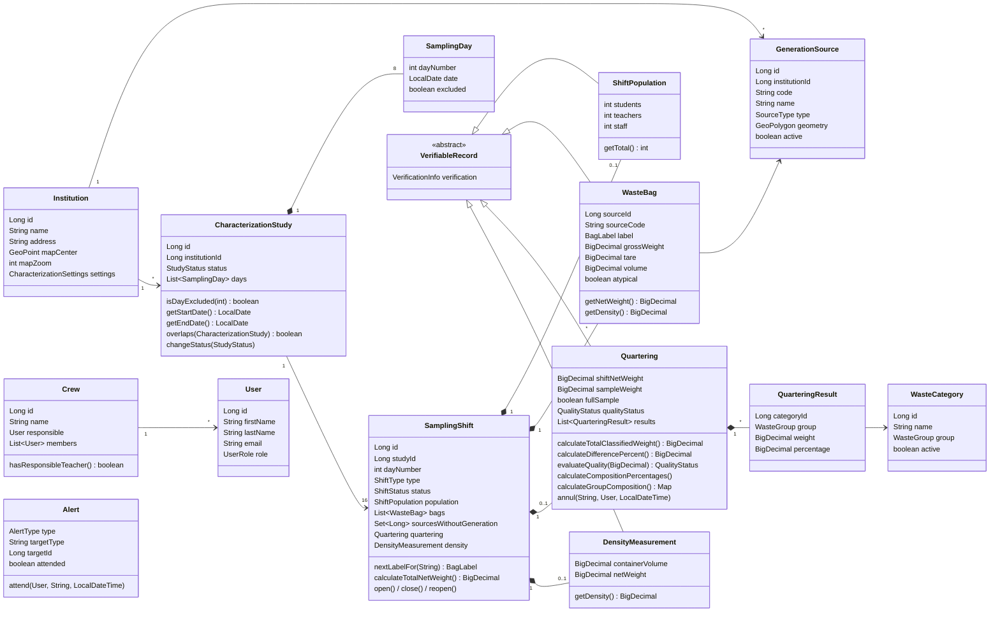

# Plan — Spec 001: Dominio de caracterización

| Campo | Valor |
| --- | --- |
| Estado | **APROBADO** (11 nov 2026) — R1 pendiente de confirmar |
| Spec | [spec.md](spec.md) (aprobada) |
| Redacta / implementa | Claude |
| Revisa | Antigravity y equipo |
| Rama | `feature/001-dominio-caracterizacion` |
| Fecha | 2026-11-11 |

## 1. Resumen

La spec 001 se construye como **Java puro**: modelo, validadores y excepciones, sin Spring, sin base de datos y sin pantallas. Todo se prueba con JUnit 5.

Al empezar se elimina el código del modelo anterior (decisión D11): Swing, repositorios de archivos, servicios y clases de puntos ecológicos. Al terminar, el proyecto compila y pasa las pruebas, aunque todavía no tiene aplicación que ejecutar. La aplicación vuelve con Spring Boot en las specs 002 y 003.

## 2. Qué se elimina

Antes de borrar, se crea el tag `v1-modelo-anterior` sobre `develop`, para poder consultar el código viejo cuando se necesite.

| Elemento | Motivo |
| --- | --- |
| `com.ecopoint.ui` (8 clases Swing) | La interfaz pasa a ser web (spec 004) |
| `com.ecopoint.persistence` (interfaces y `File*Repository`, `FileStorageHelper`) | Pasa a PostgreSQL; los repositorios nuevos se definen en la spec 002 |
| `com.ecopoint.service` (5 servicios) | Dependen del modelo viejo; los servicios nuevos se crean en las specs 002 a 006 |
| `Main.java` | Lanzaba Swing; la clase de arranque de Spring Boot llega en la spec 002/003 |
| `model`: `EcologicalPoint`, `Container`, `ContainerDetail`, `InspectionDay`, `InspectionRecord`, `Zone` | D1: sale la auditoría de puntos ecológicos. `Zone` se reemplaza por `GenerationSource` |
| `validation`: `EcologicalPointValidator`, `InspectionValidator` | Se reemplazan por los validadores nuevos |

Las clases `Institution`, `User`, `WasteCategory`, `Quartering`, `QuarteringResult`, `Alert`, `Evidence`, `UserValidator` y `QuarteringValidator` **se reescriben**: se conservan el nombre y la idea, pero cambian sus campos y sus reglas.

## 3. Estructura resultante

```
src/main/java/com/ecopoint/
  exceptions/   EcoPointException, InvalidDataException, BusinessRuleException,
                ResourceNotFoundException, PersistenceException,
                QualityControlException (nueva), AccessDeniedException (nueva)
  model/        enums, objetos de valor y entidades (sección 4)
  validation/   validadores y AccessPolicy (sección 5)
src/test/java/com/ecopoint/
  model/        pruebas de cálculos e invariantes
  validation/   pruebas de reglas y permisos
```

Los paquetes de modelo y validación quedan planos (sin subpaquetes), como hoy.

## 4. Modelo de dominio

### 4.1 Diagrama



`SamplingShift` es el **agregado** central: agrupa todo lo que ocurre en un turno. Por eso, como Experto en Información, sabe generar el rótulo siguiente, calcular su peso neto total y si se puede cerrar.

> Nota: el estudio tiene 8 días × 2 turnos = **16 turnos**. La spec 006 menciona "14 turnos", que corresponde a los días 2 a 8 que entran en los cálculos.

### 4.2 Enums

| Enum | Valores | Comportamiento |
| --- | --- | --- |
| `WasteGroup` | BLANCO, VERDE, NEGRO, SIN_COLOR | `getDisplayName()`, `isRecoverable()` (true para BLANCO y VERDE), `isHazardous()` (SIN_COLOR) |
| `SourceType` | AULAS, OFICINAS, TIENDA_ESCOLAR, PAE, ZONAS_VERDES, BANOS, LABORATORIO, OTRA | `getDisplayName()` |
| `ShiftType` | MANANA, TARDE | `getCode()` → "M" / "T" |
| `ShiftStatus` | ABIERTO, CERRADO | — |
| `StudyStatus` | PLANIFICADO, EN_EJECUCION, EN_DEPURACION, CERRADO | `canTransitionTo(StudyStatus)`: solo avanza un paso; además CERRADO → EN_DEPURACION (RN-017) |
| `VerificationStatus` | PENDIENTE, VERIFICADO, CORREGIDO | — |
| `QualityStatus` | CONFORME, NO_CONFORME, ANULADO | — |
| `UserRole` | DOCENTE, ESTUDIANTE_UNIVERSITARIO (D9) | `hasPermission(Permission)` con la matriz RN-081; `canSuperviseCrew()` (RN-085) |
| `Permission` | Una constante por fila de la matriz RN-081 (ej. `MANAGE_ADMINISTRATION`, `REGISTER_BAGS`, `REGISTER_HAZARDOUS_WASTE`, `VERIFY_RECORDS`…) | — |
| `AlertType` | CUARTEO_NO_CONFORME, VALOR_ATIPICO, VERIFICACION_PENDIENTE | — |
| `EvidenceTarget` | SHIFT, BAG, QUARTERING | — |

La matriz de permisos se define **una sola vez**, dentro de `UserRole` (con un `EnumSet` por rol), y la usan el dominio, la API y las pantallas.

### 4.3 Objetos de valor

Objetos inmutables (`record` de Java 17) con su propia validación en el constructor:

| Clase | Contenido | Regla |
| --- | --- | --- |
| `GeoPoint` | `latitude`, `longitude` (`BigDecimal`) | Latitud −90..90, longitud −180..180 (RN-004) |
| `GeoPolygon` | `List<GeoPoint> vertices` | Cerrado, ≥ 3 vértices distintos (RN-004) |
| `BagLabel` | `sourceCode`, `dayNumber`, `shiftType`, `sequence` (0 = sin consecutivo) | `toString()` → `AU-D3-M` o `AU-D3-M-2` (RN-031) |
| `CharacterizationSettings` | Rango de submuestra (45–55 kg), tolerancia (2 %), peso neto máximo por bolsa (50 kg), densidad mínima y máxima (20–1 000 kg/m³) | `defaults()` con esos valores (D8, RN-037, RN-052) |

### 4.4 Verificación y correcciones (RN-060 a RN-063)

- `VerificationInfo`: `status`, `enteredBy` (id de usuario), `enteredAt`, `verifiedBy`, `verifiedAt`. Métodos `markVerified(Long userId, LocalDateTime at)` y `markCorrected(Long userId, LocalDateTime at)`.
- `VerifiableRecord` (clase **abstracta**): base de `ShiftPopulation`, `WasteBag`, `Quartering` y `DensityMeasurement`. Contiene `id` y `VerificationInfo`. Así las cuatro se verifican igual (polimorfismo) y la bandeja de verificación de la spec 005 las trata como una sola lista.
- `Correction`: registro inmutable de un cambio: `targetType`, `targetId`, `field`, `oldValue`, `newValue`, `reason`, `userId`, `at`. Un registro corregido produce una `Correction` por cada campo cambiado.

### 4.5 Alertas

- `Alert`: `type`, `targetType`, `targetId`, `description` (español), `createdAt`, `attended`, `attendedBy`, `attendedAt`, `attendNote`. Método `attend(User, String note, LocalDateTime)`: falla si ya está atendida o si la nota está vacía (RN-073).
- `AlertFactory` (clase de utilidad del modelo, Creador GRASP) con `forNonConformingQuartering(Quartering, LocalDateTime)` y `forAtypicalBag(WasteBag, LocalDateTime)`. El dominio **crea** las alertas; guardarlas es trabajo del servicio (specs 002 y 005).

### 4.6 Evidencias

`Evidence`: `target` (`EvidenceTarget`), `targetId`, `filePath`, `mimeType`, `sizeBytes`, `description`, `uploadedAt`. Lo valida `EvidenceValidator` (RN-090).

## 5. Validadores y permisos

Clases `final`, sin estado, con métodos `static`, como las actuales. Cada regla que necesita datos de otros objetos los recibe como parámetro, porque el dominio no consulta la base de datos.

| Clase | Métodos principales | Reglas |
| --- | --- | --- |
| `InstitutionValidator` | `validate(institution)` | Nombre, dirección y zoom del mapa (0 a 22) |
| `GenerationSourceValidator` | `validate(source)`, `validateUniqueCode(source, Set<String> existingCodes)`, `validateDeletion(source, boolean hasBags)`, `validateAvailableForRegistration(source)` | RN-001 a RN-005 |
| `WasteCategoryValidator` | `validate(category)`, `validateUniqueName(category, Set<String> existingNames)`, `validateGroupChange(category, WasteGroup previousGroup, boolean hasResults)`, `validateDeletion(category, boolean hasResults)` | RN-041, RN-042 |
| `StudyValidator` | `validate(study)`, `validateNoOverlap(study, List<CharacterizationStudy> others)`, `validateStartExecution(study, int activeSources)`, `validateClose(study, int pendingRecords, int unresolvedQuarterings)` | RN-010 a RN-016 |
| `ShiftValidator` | `validatePopulation(population)`, `validateCanRegisterBag(shift)`, `validateCanClose(shift, Set<Long> participatingSourceIds)` | RN-020 a RN-024 |
| `WasteBagValidator` | `validate(bag, shift, Set<Long> participatingSourceIds)`, `isAtypical(bag, settings)` | RN-030 a RN-037 |
| `QuarteringValidator` | `validate(quartering, shift, settings)`, `validateCategories(quartering, Map<Long, WasteCategory>)`, `validateNoExistingQuartering(shift)` | RN-050, RN-051, RN-055 |
| `DensityValidator` | `validate(measurement, shift)` | RN-057 |
| `VerificationValidator` | `validateVerifier(record, user)`, `validateCorrection(record, user, reason)` | RN-062, RN-063 |
| `UserValidator` | `validate(user)`, `validateUniqueEmail(user, Set<String> existingEmails)` | RN-084 |
| `CrewValidator` | `validate(crew)` | RN-085 |
| `EvidenceValidator` | `validate(evidence)` | RN-090 |
| `AccessPolicy` | `require(User user, Permission permission)` | RN-081; lanza `AccessDeniedException` |

**El control del 2 % (RN-052) no es un rechazo.** El cuarteo NO_CONFORME **se guarda** y genera una alerta, para que la cuadrilla repese. Por eso `Quartering.evaluateQuality(...)` devuelve el estado y no lanza excepción. `QualityControlException` se usa solo cuando se intenta una acción que exige un cuarteo conforme, como cerrar el estudio con un cuarteo no conforme sin resolver.

**RN-056** (residuos peligrosos solo con el permiso correspondiente; hoy lo tienen los dos roles) se valida con `AccessPolicy.require(user, Permission.REGISTER_HAZARDOUS_WASTE)` cuando un resultado del cuarteo pertenece al grupo SIN_COLOR.

## 6. Excepciones nuevas

| Clase | Hereda de | `errorCode` | Uso |
| --- | --- | --- | --- |
| `QualityControlException` | `BusinessRuleException` | `ERR_QUALITY_CONTROL` | Acción bloqueada por un cuarteo NO_CONFORME (HTTP 422) |
| `AccessDeniedException` | `EcoPointException` | `ERR_FORBIDDEN` | El rol no tiene el permiso (HTTP 403) |

`AccessDeniedException` no estaba en la lista de la spec 001 (CA-090 menciona tres tipos), pero la spec 003 exige responder 403 a las acciones no permitidas (CA-203, CA-204). Hace falta una excepción propia para distinguirlas de una regla de negocio (422).

## 7. Decisiones técnicas

| # | Decisión | Por qué |
| --- | --- | --- |
| T1 | Java puro en la spec 001; Spring entra en la 002/003 | El dominio no debe depender del framework; se prueba rápido y aislado |
| T2 | `BigDecimal` con escala 2 para kg y %, escala 3 para m³, `HALF_UP`; los cálculos intermedios usan `MathContext.DECIMAL64` | Evita errores de redondeo (CA-052, CA-054) |
| T3 | Identificadores `Long` (null = no guardado) | Lo mapea directo la spec 002 |
| T4 | Objetos de valor como `record` | Inmutables, `equals` y `hashCode` gratis |
| T5 | Fecha y hora como parámetro de los métodos | Pruebas deterministas, sin depender del reloj |
| T6 | Matriz de permisos dentro de `UserRole` | Una sola fuente de verdad para dominio, API y frontend |
| T7 | Se agrega el Maven Wrapper (`mvnw`) | Compila igual en todos los computadores sin instalar Maven (en el computador de Carlos no está instalado) |
| T8 | JUnit Jupiter 5.11 + `maven-surefire-plugin` 3.5 | Las pruebas corren con `./mvnw test` |
| T9 | Se agrega `target/` al `.gitignore` | Hoy no está ignorado |

## 8. Trazabilidad de criterios de aceptación

| CA | Prueba (clase de test) |
| --- | --- |
| CA-001 a CA-003 | `GenerationSourceValidatorTest`, `GeoPolygonTest` |
| CA-010 a CA-014 | `CharacterizationStudyTest`, `StudyStatusTest`, `StudyValidatorTest` |
| CA-020 a CA-023 | `SamplingShiftTest`, `ShiftValidatorTest` |
| CA-030 a CA-033 | `BagLabelTest`, `SamplingShiftTest`, `WasteBagTest`, `WasteBagValidatorTest`, `AlertFactoryTest` |
| CA-050 a CA-056 | `QuarteringTest`, `QuarteringValidatorTest`, `AccessPolicyTest` |
| CA-060 a CA-062 | `VerificationValidatorTest`, `VerificationInfoTest` |
| CA-080, CA-081 | `UserValidatorTest`, `CrewValidatorTest` |
| CA-090 | `ExceptionMappingTest` (prueba parametrizada que recorre los rechazos) |
| RN-081 (matriz completa) | `UserRolePermissionTest` (una prueba por celda de la matriz) |

## 9. Riesgos y puntos a confirmar

| # | Tema | Propuesta |
| --- | --- | --- |
| R1 | **Rótulo al agregar una segunda bolsa.** CA-030 dice que al registrar la segunda bolsa de la misma fuente y turno, los rótulos quedan `AU-D3-M-1` y `AU-D3-M-2`. Pero la primera bolsa ya fue rotulada a mano como `AU-D3-M`, y cambiarle el rótulo en el sistema haría que no coincida con la bolsa física ni con la planilla. | Que la primera conserve `AU-D3-M` y las siguientes sean `AU-D3-M-2`, `AU-D3-M-3`. **Requiere ajustar CA-030; confirmar con el equipo.** Mientras no se confirme, se implementa como dice la spec. |
| R2 | Borrar el código viejo deja el proyecto sin aplicación ejecutable hasta la spec 003. | Se acepta (D11). El tag `v1-modelo-anterior` conserva la versión Swing. |
| R3 | `@author` en el JavaDoc de las clases nuevas. | **Decidido:** según el reparto de paquetes de `src/TEAM.md` (sección 10). |

## 10. Responsables por paquete (`@author`)

Según `src/TEAM.md`:

| Paquete o archivo | Responsable | `@author` |
| --- | --- | --- |
| `com.ecopoint.exceptions` | Merlín Yelenis Landero Cuello | `mlanderoc` |
| `pom.xml`, Maven Wrapper, `docs/` | Merlín Yelenis Landero Cuello | `mlanderoc` |
| `com.ecopoint.model` | Estefanía Márquez Martínez | `EstefaniaMarquez` |
| `com.ecopoint.validation` (incluye `AccessPolicy`) | Carlos Raúl Gómez Galvis | `craulgomez` |

Las pruebas llevan el `@author` del responsable de la clase que prueban.
