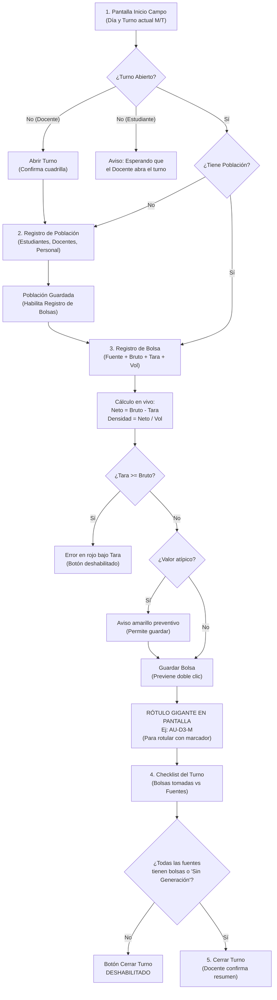

# Plan — Spec 004: Configuración del estudio y registro en campo

| Campo | Valor |
| --- | --- |
| Estado | **APROBADO** (11 nov 2026) |
| Spec | [spec.md](spec.md) (aprobada) |
| Redacta / implementa | Antigravity |
| Revisa | Claude y equipo |
| Rama | `feature/004-registro-en-campo` |
| Fecha | 2026-11-11 |

---

## 1. Resumen Ejecutivo

La **Spec 004** implementa la primera versión navegable del frontend web de **EcoPoint Edu**, cubriendo la autenticación, el control de acceso por rol, la administración básica, la configuración del estudio de caracterización de 8 días y el flujo ergonómico de **registro en campo**.

El diseño y la arquitectura están orientados a resolver la realidad operativa del muestreo: **de pie, en dispositivo móvil (desde 360 px de ancho), bajo luz solar directa y con guantes de látex o nitrilo**. La aplicación debe permitir registrar una bolsa en menos de 30 segundos, generar el rótulo físico de marcación de inmediato en tipografía gigante y evitar cualquier pérdida o duplicación de datos por doble toque o desconexión transitoria.

Para desacoplar el desarrollo de la interfaz de la implementación del backend Spring Boot (Spec 003), el frontend incluye una capa de **Mock Service Worker (MSW v3)** que intercepta las peticiones `/api/v1/*` a nivel de red en el navegador. La autenticación y sesión se gestionan mediante **cookies `HttpOnly`** del servidor (`withCredentials: true`), sin exponer tokens en JavaScript ni en LocalStorage. Esto permite ejecutar y probar el 100 % de los criterios de aceptación (CA-300 a CA-310) sin depender de que el backend esté levantado, conmutando a producción de forma transparente mediante una variable de entorno (`VITE_USE_MOCK_API=false`).

---

## 2. Decisiones Arquitectónicas y Tecnológicas

### 2.1 Stack del Frontend

| Capa / Módulo | Tecnología | Justificación |
| --- | --- | --- |
| **Framework & Build** | React 19 con Vite 8 y TypeScript 7 | Arranque instantáneo (HMR subsegundo), tipado estricto alineado con los DTOs de la Spec 003, estándar acordado en decisión D4. |
| **Estilos & Diseño** | Tailwind CSS v4 (`@tailwindcss/vite`) + Radix UI Primitives | Sistema de diseño declarativo de última generación, configuración simplificada en CSS moderno con `@theme`, tokens directos de la paleta del logo y accesibilidad WAI-ARIA nativa (foco, teclado, lectores de pantalla). |
| **Estado del Servidor & Caché** | TanStack Query (React Query v5) | Manejo de estados asíncronos (`isLoading`, `isError`), invalidación automática tras mutaciones y deshabilitación nativa de botones en mutación activa (R-305, CA-310). |
| **Gestión de Formularios** | React Hook Form v7 + Zod 4 | Formularios no controlados de alto rendimiento en móviles, esquemas de validación Zod sincronizados con las reglas de negocio del dominio (tara < bruto, población ≥ 0). |
| **Enrutamiento** | React Router v7 | Enrutamiento SPA declarativo, layouts anidados (`AppLayout`, `AuthLayout`), guards por rol (`RequireRole`, `RequireAuth`). |
| **Gestión de Sesión** | Cookie `HttpOnly` del servidor (`withCredentials: true`) | Seguridad estricta según propuesta P1 de la Spec 003. El frontend no manipula ni almacena tokens JWT en `localStorage`; la sesión reside en la cookie y el cliente consulta `GET /api/v1/auth/me` para obtener el estado y los datos del usuario. |
| **Mock API** | Mock Service Worker (MSW v3) | Simulación fiel a nivel de Service Worker del contrato de API REST de la Spec 003, incluyendo el ciclo de cookies de sesión, los códigos de error HTTP (400, 401, 403, 404, 422, 500) y la estructura estándar `{timestamp, status, errorCode, message, path, fieldErrors}`. |
| **Iconografía** | Lucide React | Iconos SVG legibles, ligeros, consistentes y escalables para interfaces táctiles. |
| **Pruebas Automatizadas** | Vitest 5 + React Testing Library + MSW v3 | Pruebas unitarias y de integración que simulan la interacción real del usuario y verifican los criterios CA-300 a CA-310. |

### 2.2 Roles del Sistema (Decisión D9 del equipo y Matriz RN-081)

El sistema opera estrictamente con **dos roles de usuario**:
1. **`DOCENTE`**: Administrador y supervisor del estudio. Gestiona instituciones, fuentes, usuarios y cuadrillas; crea y avanza estudios de caracterización; abre y cierra turnos de muestreo; aprueba o corrige registros.
2. **`ESTUDIANTE_UNIVERSITARIO`**: Integrante operativo clave del equipo de caracterización.
   - **En la Spec 004:** Registra la población del turno, realiza el pesaje y registro de bolsas con rótulo automático, y marca fuentes sin generación.
   - **En las Specs 005 y 006 (según RN-081):** Registra cuarteos y mediciones de densidad volumétrica, registra residuos peligrosos, anula cuarteos no válidos, efectúa el doble registro verificando registros de otros integrantes y atiende alertas del sistema.
   - **Acciones restringidas:** No tiene permitido administrar catálogos (instituciones, fuentes, usuarios, cuadrillas), crear estudios, cambiar el estado del estudio ni abrir o cerrar turnos de muestreo (CA-300, RN-081).
   
   > [!NOTE]
   > La arquitectura del menú, el enrutador y las guardas de acceso (`RequireRole`, `RequirePermission`) se estructura desde esta spec para soportar progresivamente las capacidades operativas del estudiante en las specs 005 y 006 sin requerir refactorizaciones mayores.

> [!IMPORTANT]
> Se descartan definitivamente los roles de `COORDINADOR` y `ESTUDIANTE_COLEGIO`. No existen flujos de consentimiento de menores ni restricciones de cuadrilla con adultos en el frontend.

---

## 3. Estructura del Proyecto (`frontend/`)

El frontend se organiza bajo una arquitectura modular por características (*Feature-Driven Architecture*):

```
frontend/
├── index.html                       # Entrada HTML con meta viewport móvil
├── package.json                     # Scripts y dependencias
├── tsconfig.json                    # Configuración estricta de TypeScript
├── vite.config.ts                   # Configuración de Vite con @tailwindcss/vite y alias @/*
├── src/
│   ├── assets/                      # Logo de EcoPoint Edu (SVG/PNG), íconos
│   ├── components/                  # Componentes reutilizables generales
│   │   ├── ui/                      # Átomos y moléculas (Button, Input, Select, Modal, Card, Badge, Alert)
│   │   ├── layout/                  # AppLayout, Header, Sidebar (desktop), BottomNav (móvil)
│   │   └── waste/                   # WasteGroupBadge, WasteGroupChip (Colores Res. 2184 + texto explícito)
│   ├── features/                    # Módulos de funcionalidad de negocio
│   │   ├── auth/                    # Login, contexto de sesión, hooks useAuth, protección de rutas
│   │   │   ├── components/          # LoginForm, SessionExpiryModal
│   │   │   ├── hooks/               # useAuth, useLogin, useLogout
│   │   │   ├── services/            # authService.ts (login, logout, getMe con withCredentials)
│   │   │   └── types/               # AuthUser, LoginRequest, AuthResponse
│   │   ├── admin/                   # Administración de catálogos y entidades (solo Docente)
│   │   │   ├── institutions/        # Listado y formulario de instituciones
│   │   │   ├── sources/             # Listado y formulario de fuentes de generación
│   │   │   ├── users/               # Listado y formulario de usuarios (validación correo único CA-302)
│   │   │   ├── crews/               # Gestión de cuadrillas y asignación de docentes/estudiantes
│   │   │   └── categories/          # Listado y creación de subcategorías de residuos
│   │   ├── study/                   # Configuración y ciclo de vida del estudio de 8 días
│   │   │   ├── components/          # StudyForm, DaysScheduler (cálculo días hábiles CA-301), SourceSelector
│   │   │   ├── hooks/               # useStudies, useCreateStudy, useStudyLifecycle
│   │   │   └── services/            # studyService.ts
│   │   └── field/                   # Registro en campo y operación de turnos
│   │       ├── components/          # ShiftHeader, PopulationForm, BagForm, LabelDisplay, SourceChecklist
│   │       ├── hooks/               # useCurrentShift, useShiftActions, useBagRegistration
│   │       └── services/            # shiftService.ts, bagService.ts
│   ├── services/                    # Cliente HTTP base y manejo global de errores
│   │   ├── apiClient.ts             # Instancia Axios/Fetch (baseURL /api/v1, withCredentials: true)
│   │   └── errorHandler.ts          # Normalizador de errores en el formato Spec 003
│   ├── mocks/                       # Simulación de backend (MSW v3)
│   │   ├── browser.ts               # Inicialización del Service Worker en navegador
│   │   ├── handlers.ts              # Controladores REST con simulación de cookie de sesión (/auth, /studies, etc.)
│   │   └── data/                    # Semillas realistas (I.E. Prudencia Daza, fuentes, usuarios semilla)
│   ├── types/                       # Definiciones TypeScript de entidades y contratos API
│   │   ├── api.ts                   # ErrorResponse, FieldError, ApiResult
│   │   └── domain.ts                # UserRole, WasteGroup, StudyStatus, ShiftType, BagLabel...
│   ├── utils/                       # Utilidades de cálculo, fechas y formateo
│   │   ├── dateUtils.ts             # Cálculo de 7 días hábiles (lunes a viernes, CA-301)
│   │   ├── numberUtils.ts           # Formato de pesos y densidades con 2 decimales (BigDecimal)
│   │   └── storage.ts               # LocalStorage exclusivamente para preferencias de UI (tema, etc.; nunca tokens)
│   ├── styles/
│   │   └── main.css                 # Importación de @import "tailwindcss" y variables de tokens
│   ├── App.tsx                      # Configuración de proveedores (QueryClient, AuthProvider, Router)
│   └── main.tsx                     # Punto de entrada de la aplicación
```

---

## 4. Sistema de Diseño y Ergonomía de Campo

### 4.1 Paleta de Color Institucional y Tokens

Basada en la identidad visual del logo de **EcoPoint Edu** y los lineamientos de la Resolución 2184 de 2019 (R-304):

```css
:root {
  /* Marca EcoPoint Edu */
  --color-primary: #1E8449;        /* Verde Eco principal - Botones de acción, cabeceras interactivas */
  --color-primary-hover: #145A32;  /* Verde oscuro para estados hover y active */
  --color-primary-light: #E8F5E9;  /* Verde tenue para fondos y contenedores suaves */
  --color-brand-dark: #0F3D23;     /* Verde pino oscuro - Barra de navegación, títulos y footer */
  --color-accent-leaf: #8BC34A;    /* Verde hoja viva - Indicadores de estado activo y detalles */
  --color-edu-blue: #2F5DA8;       /* Azul del texto 'Edu' del logo - Roles, enlaces y datos secundarios */

  /* Residuos Sólidos (Res. 2184/2019 + Nombre explícito R-304) */
  --color-waste-white: #FFFFFF;    /* Blanco: Aprovechables limpios (borde #94A3B8) */
  --color-waste-green: #27AE60;    /* Verde Orgánico: Aprovechables orgánicos (tono diferenciado de botones) */
  --color-waste-black: #1E293B;    /* Negro: No aprovechables / Ordinarios */
  --color-waste-none: #64748B;     /* Gris / Sin color: Residuos especiales o no clasificados */

  /* Estados y Avisos */
  --color-warning: #D97706;        /* Ámbar: Valores atípicos (R-344) */
  --color-warning-bg: #FEF3C7;     /* Fondo de alerta preventiva */
  --color-danger: #DC2626;         /* Rojo: Errores de validación y bloqueos */
  --color-danger-bg: #FEE2E2;      /* Fondo de error */
  --color-success: #16A34A;        /* Verde éxito */
  
  /* Superficie y Texto con Alto Contraste Solar (WCAG AAA >= 7:1) */
  --color-bg-app: #F8FAFC;         /* Gris ultra claro para evitar reflejo solar excesivo */
  --color-text-main: #0F172A;      /* Casi negro para máxima nitidez */
  --color-text-muted: #334155;     /* Gris oscuro de alta legibilidad */
}
```

> [!IMPORTANT]
> **Diferenciación de color y representación de residuos (R-304):**
> El color del grupo Verde (`--color-waste-green: #27AE60`) utiliza un tono esmeralda orgánico diferenciado del Verde Eco de botones principales (`--color-primary: #1E8449`). Los grupos de residuos se representan **exclusivamente como chips y badges informativos** (`WasteGroupBadge`, `WasteGroupChip`), **nunca como botones interactivos**, y siempre incluyen su nombre textual legible (ej. *"Verde: Orgánicos aprovechables"*), asegurando que el color no sea la única vía de distinción.

### 4.2 Ergonomía Móvil y Operación al Sol (R-300, R-301, R-302, CA-307, CA-308)

1. **Objetivos Táctiles Ampliados (Touch Targets ≥ 48 px):**
   - Todos los botones interactivos, campos de formulario, tarjetas de selección de fuente e interruptores tienen una altura mínima de `48px` (`min-h-[48px]`) y un padding de toque mínimo de `12px`.
   - Espaciado vertical entre campos de al menos `16px` para evitar pulsaciones erróneas con dedos enguantados.
2. **Teclado Numérico y Entrada Decimal (R-302):**
   - Los campos de peso bruto, tara y volumen utilizan `<input type="text" inputMode="decimal" pattern="[0-9]*[.,]?[0-9]*" />`.
   - Se procesan automáticamente tanto la coma `,` como el punto `.` como separadores decimales antes de la conversión a número.
3. **Visibilidad bajo Luz Solar Directa:**
   - Tipografía con pesos definidos (`font-semibold` o `font-bold` en datos críticos).
   - Contraste superior a 7:1 en cifras de peso, volumen, alertas y rótulo de bolsa.
   - Sin efectos de transparencia sutiles ni sombras difusas de bajo contraste que se pierdan con el reflejo de la pantalla al aire libre.
4. **Layout Adaptativo (Desktop vs Móvil):**
   - **Escritorio / Tableta (≥ 768 px):** Barra lateral izquierda fija (`Sidebar`) con logotipo, opciones completas de menú, datos del usuario y rol.
   - **Móvil (< 768 px, base 360 px):** Barra de navegación inferior fija (`BottomNavigation`) con acceso rápido a 4 secciones: *Campo*, *Bolsas*, *Alertas* y *Perfil*. Encabezado superior compacto con el turno activo. Cero desplazamiento horizontal en 360 px (CA-307).

---

## 5. Especificación Detallada de Pantallas y Flujos

### 5.1 Autenticación e Inicio de Sesión (`/login`)
- Formulario limpio con correo institucional y contraseña (R-310).
- Validación en tiempo real del formato de correo.
- Indicador de carga y botón bloqueado durante la autenticación.
- Notificación explícita de "Su sesión expiró" si la petición es rechazada con HTTP 401 (R-312).
- **Manejo de Sesión Segura:** Al autenticarse con éxito, el servidor establece la cookie de sesión `HttpOnly`. El cliente HTTP utiliza `withCredentials: true` y no almacena ningún token en `localStorage`. Inmediatamente consulta `GET /api/v1/auth/me` para sincronizar el estado del usuario en el contexto de React.

### 5.2 Menú y Rutas Protegidas según Rol (R-311, CA-300)
- **Componente `RequireRole`:** Intercepta la navegación. Si un `ESTUDIANTE_UNIVERSITARIO` intenta acceder por URL directa a `/admin/*` o `/estudios/nuevo`, es redirigido a `/campo` con una advertencia visual.
- **Barra de Navegación Condicional:**
  - `DOCENTE`: Inicio, Configuración de Estudios, Registro en Campo, Administración (Instituciones, Fuentes, Usuarios, Cuadrillas, Subcategorías), Historial y Alertas.
  - `ESTUDIANTE_UNIVERSITARIO`: Menú simplificado para la Spec 004: Registro en Campo y Mi Perfil (con arquitectura preparada para cuarteo, densidad y alertas en Specs 005/006).

### 5.3 Módulo de Administración (Solo Docente)
- **Instituciones (`/admin/instituciones`):** Listado y modal para registrar/editar nombre, dirección y configuración por defecto (R-320).
- **Fuentes de Generación (`/admin/fuentes`):** Listado por institución con código (ej. `AU`, `BA`, `OF`), nombre, tipo (Aulas, Oficinas, Baños, Cafetería, etc.) y estado activo/inactivo (R-321).
- **Usuarios (`/admin/usuarios`):** Registro de integrantes. Validación de unicidad de correo institucional (CA-302); si la API responde error 400 con `field: "email"`, el formulario marca el campo de correo en rojo con el mensaje devuelto.
- **Cuadrillas (`/admin/cuadrillas`):** Creación de cuadrillas con nombre, docente responsable (obligatorio, RN-085) y lista de estudiantes universitarios. Alerta preventiva en color naranja si no se ha asignado docente responsable.
- **Subcategorías (`/admin/subcategorias`):** Gestión de subcategorías clasificadas por los 4 grupos de la Res. 2184/2019 (R-324).

### 5.4 Configuración del Estudio de Caracterización (Solo Docente)
- **Creación de Estudio (`/estudios/nuevo`):**
  - Selección de la institución participante.
  - Selección de la fecha del **Día 1**.
  - **Planificador Inteligente de Fechas (R-330, CA-301):** Función `calculateSamplingDays(startDate)` que calcula automáticamente los siguientes 7 días hábiles consecutivos (lunes a viernes), excluyendo sábados y domingos. El docente puede ajustar cualquier fecha si hay festivos o jornadas especiales.
  - El Día 1 se resalta visualmente con un banner informativo: *"Día de descarte: no entra en los cálculos de generación per cápita ni línea base"* (R-333).
  - Selección de fuentes participantes (por defecto todas las activas, R-331).
  - Asignación de cuadrillas por turno con opción de replicar la configuración a todos los días del estudio.
- **Monitor de Ciclo de Vida del Estudio (`/estudios/:id`):**
  - Barra de progreso del estudio (Días 1 a 8, turnos M y T).
  - Botones de transición de estado (`EN_EJECUCION`, `FINALIZADO`, `CERRADO`) protegidos con diálogo de confirmación.
  - Si una transición está bloqueada por reglas de negocio (ej. registros pendientes de verificación, RN-014), el sistema muestra el motivo exacto en un cuadro explicativo rojo (R-332, CA-309).

### 5.5 Flujo de Registro en Campo (Móvil First, 5 Pasos)



#### Paso 1: Dashboard de Campo (`/campo`)
- Muestra el estudio en curso, el día de muestreo (1 al 8) y el turno activo (Mañana / Tarde) sugerido automáticamente según la hora local (R-340).
- Si el turno está cerrado, el docente visualiza el botón primario de 48 px **"Abrir Turno"** (R-341). El estudiante universitario visualiza el estado *"Turno no iniciado"* sin botón de apertura (CA-300).

#### Paso 2: Registro de Población (`/campo/turno/:id/poblacion`)
- Formulario con tres campos numéricos: *Estudiantes presentes*, *Docentes* y *Personal administrativo/servicios*.
- Cálculo automático en tiempo real del *Total Población* (R-342).
- **Control de Acceso Invariable:** Mientras la población no haya sido registrada y guardada, cualquier intento de acceder al registro de bolsas muestra un contenedor bloqueado con la leyenda: *"Registre primero la población del turno para habilitar el pesaje de bolsas"* (R-342, CA-303).

#### Paso 3: Registro de Bolsa (`/campo/turno/:id/bolsas/nueva`)
- **Selección de Fuente:** Cuadrícula de botones táctiles grandes (mínimo 60 px de alto) con el código en grande (ej. `AU`, `BA`, `CAF`) y el nombre completo de la fuente (R-343).
- **Ingreso de Pesos y Volumen:**
  - Campo *Peso Bruto (kg)*.
  - Campo *Tara del recipiente (kg)*.
  - Campo *Volumen de la bolsa (m³)*.
- **Cálculos Dinámicos en Pantalla:**
  - Peso Neto calculado: $\text{Peso Neto} = \text{Bruto} - \text{Tara}$.
  - Densidad estimada: $\text{Densidad} = \frac{\text{Peso Neto}}{\text{Volumen}}\ (\text{kg/m}^3)$.
- **Validaciones en Cliente y Prevención de Errores:**
  - Si $\text{Tara} \ge \text{Bruto}$, el campo *Tara* se resalta de inmediato con borde rojo y el texto explicativo: *"La tara no puede superar el peso bruto"*, deshabilitando el botón de guardado (R-305, CA-305).
  - Si el peso neto o la densidad superan los umbrales históricos o lógicos del protocolo (RN-037), se despliega un aviso ámbar: *"Valor fuera de lo esperado; revise antes de continuar"*, permitiendo guardar tras confirmación (R-344).
  - Al pulsar "Guardar Bolsa", el botón entra en estado de carga con spinner y queda inhabilitado para evitar peticiones duplicadas ante doble toque involuntario (R-305, CA-310).
- **Presentación del Rótulo Físico (R-343, CA-304):**
  - Tras el guardado exitoso, la pantalla muestra de inmediato una tarjeta a pantalla completa con el **Rótulo Generado en tipografía monoespaciada gigante** (`text-5xl font-black`, ej. `AU-D3-M`).
  - Botón grande "Siguiente Bolsa" para reiniciar el formulario en blanco manteniendo la agilidad operativa para completar el ciclo en menos de 30 segundos (CA-308).

#### Paso 4: Monitoreo y Checklist de Fuentes del Turno (`/campo/turno/:id`)
- Lista de chequeo visual de todas las fuentes participantes del estudio en el turno (R-345).
- Cada fila muestra:
  - Código y nombre de la fuente.
  - Estado: *Con bolsas registradas* (muestra cantidad y peso acumulado), *Sin generación reportada* o *Pendiente*.
  - Para fuentes pendientes: botón táctil directo **"Marcar sin generación"** para declarar formalmente que la fuente no produjo residuos en esa jornada.

#### Paso 5: Cierre del Turno (`/campo/turno/:id/cierre`)
- Exclusivo para el usuario con rol `DOCENTE` (R-346, CA-300).
- **Validación de Bloqueo:** El botón "Cerrar Turno" permanece desactivado si existe al menos una fuente en estado *Pendiente* (RN-024, CA-306). Al marcar la última fuente pendiente como "Sin generación" o registrar su bolsa, el botón se activa automáticamente.
- **Resumen de Cierre:** Modal de confirmación que consolida:
  - Total población del turno.
  - Número total de bolsas recolectadas.
  - Sumatoria total de kilogramos netos.
  - Lista de fuentes que no generaron residuos.

---

## 6. Simulación de Backend con Mock Service Worker (MSW v3)

Para garantizar la autonomía del frontend, se configura MSW interceptando las rutas bajo `/api/v1/*`. MSW simula el comportamiento de sesión basado en cookie `HttpOnly`, manteniendo el estado de sesión activa en memoria y evaluando credenciales vía `withCredentials`:

| Endpoint Simulado | Método | Comportamiento del Mock |
| --- | --- | --- |
| `/api/v1/auth/login` | `POST` | Valida credenciales (`docente@unicesar.edu.co` / `estudiante@unicesar.edu.co`). Simula el establecimiento de cookie de sesión `HttpOnly`. Si falla, devuelve 401 con mensaje genérico sin revelar si el correo existe (CA-202). |
| `/api/v1/auth/logout` | `POST` | Elimina la sesión simulada y limpia el estado de autenticación. |
| `/api/v1/auth/me` | `GET` | Si hay sesión simulada activa, devuelve el perfil del usuario, su rol e institución (CA-201); si no, devuelve 401 `ERR_UNAUTHORIZED`. |
| `/api/v1/institutions` | `GET`, `POST` | Listado y registro de instituciones educativas. |
| `/api/v1/institutions/:id/sources` | `GET`, `POST`, `PUT` | Catálogo de fuentes de la I.E. Prudencia Daza. |
| `/api/v1/users` | `GET`, `POST` | Si el correo ya existe en la base en memoria, responde HTTP 400 con `errorCode: "ERR_INVALID_DATA"` y `fieldErrors: [{ field: "email", message: "El correo ya está registrado." }]` (CA-302). |
| `/api/v1/studies` | `GET`, `POST` | Gestión de estudios. Al crear, calcula los 7 días hábiles. |
| `/api/v1/studies/:id/shifts` | `GET` | Turnos del estudio con estado de apertura y avance. |
| `/api/v1/shifts/:id/population` | `GET`, `POST` | Almacena y devuelve la población. Valida que los valores no sean negativos. |
| `/api/v1/shifts/:id/bags` | `GET`, `POST` | Valida población registrada (si no hay, devuelve 422 `ERR_BUSINESS_RULE`, CA-206). Valida `tare < grossWeight` (si no, devuelve 400 `ERR_INVALID_DATA`, CA-205). Genera rótulo correlativo `FUENTE-DÍA-TURNO`. |
| `/api/v1/shifts/:id/sources/:sourceId/no-generation` | `POST` | Marca la fuente como "sin generación" en el turno. |
| `/api/v1/shifts/:id/close` | `POST` | Valida que no queden fuentes pendientes (si quedan, devuelve 422). Cambia estado a `CERRADO`. |

---

## 7. Estrategia de Pruebas Automatizadas

Se configura un conjunto de pruebas automatizadas con **Vitest** y **React Testing Library**:

1. **Pruebas de Autenticación y Guards (`auth.test.tsx`):**
   - Verificar que un usuario sin sesión activa en `GET /api/v1/auth/me` es redirigido a `/login`.
   - Verificar que un `ESTUDIANTE_UNIVERSITARIO` no ve las opciones de menú administrativo ni los botones de abrir/cerrar turno (**CA-300**).
2. **Pruebas de Utilidades y Planificación (`dateUtils.test.ts`):**
   - Probar que al ingresar el lunes 2 de marzo de 2026 como Día 1, el algoritmo genera exactamente los días 3, 4, 5, 6, 9, 10 y 11 de marzo (**CA-301**).
3. **Pruebas de Formularios y Errores de API (`userForm.test.tsx`, `bagForm.test.tsx`):**
   - Probar que un correo duplicado resalta el campo de correo con el mensaje de la API (**CA-302**).
   - Probar que un turno sin población bloquea el formulario de bolsas con el mensaje correspondiente (**CA-303**).
   - Probar el cálculo en vivo de peso neto y densidad, y la generación del rótulo `AU-D3-M` (**CA-304**).
   - Probar que la condición $\text{tara} \ge \text{bruto}$ muestra el error en rojo e inhibe el guardado (**CA-305**).
   - Probar la deshabilitación del botón "Guardar bolsa" al hacer clic para prevenir envíos duplicados (**CA-310**).
4. **Pruebas de Flujo de Cierre de Turno (`shiftClosing.test.tsx`):**
   - Probar que una fuente sin bolsas mantiene el botón de cierre inhabilitado hasta marcarla "sin generación" (**CA-306**).
5. **Pruebas de Responsividad y Accesibilidad Táctil:**
   - Verificación de renderizado en viewport virtual de 360 px sin desbordamiento horizontal (`overflow-x: hidden`) (**CA-307**).
   - Verificación de altura mínima de 48 px en elementos interactivos (**CA-307**, R-301).

---

## 8. Matriz de Trazabilidad de Criterios de Aceptación (CA-300 a CA-310)

| Criterio | Descripción | Componente / Módulo | Verificación Automatizada |
| --- | --- | --- | --- |
| **CA-300** | Menú y botones restringidos para Estudiante Universitario | `Sidebar.tsx`, `BottomNav.tsx`, `ShiftHeader.tsx` | `test('ca300_studentMenuAndButtonsRestricted')` |
| **CA-301** | Propuesta automática de 7 días hábiles (lunes a viernes) | `dateUtils.ts`, `DaysScheduler.tsx` | `test('ca301_samplingDaysProposalSkipsWeekends')` |
| **CA-302** | Validación y marcación de correo duplicado | `UserForm.tsx`, `errorHandler.ts` | `test('ca302_duplicateEmailDisplaysFieldError')` |
| **CA-303** | Bloqueo de registro de bolsas si no hay población | `ShiftDetailView.tsx`, `BagEntrySection.tsx` | `test('ca303_shiftWithoutPopulationBlocksBagEntry')` |
| **CA-304** | Cálculo en vivo de neto/densidad y rótulo grande | `BagForm.tsx`, `LabelDisplay.tsx` | `test('ca304_netWeightDensityAndLargeLabelCalculated')` |
| **CA-305** | Error en rojo bajo tara si supera o iguala al bruto | `BagForm.tsx` (Zod schema) | `test('ca305_tareGreaterThanGrossDisplaysRedError')` |
| **CA-306** | Cierre de turno bloqueado con fuentes pendientes | `SourceChecklist.tsx`, `CloseShiftButton.tsx` | `test('ca306_shiftClosingDisabledUntilAllSourcesHandled')` |
| **CA-307** | Operación en 360 px sin scroll horizontal y táctil ≥ 48 px | `AppLayout.tsx`, `themeTokens.ts` | `test('ca307_mobile360ViewportNoHorizontalScroll')` |
| **CA-308** | Registro ágil de bolsa en menos de 30 segundos | `BagForm.tsx`, `QuickSourcePicker.tsx` | `test('ca308_bagRegistrationWorkflowErgonomics')` |
| **CA-309** | Motivo exacto visible si el estudio no puede cerrarse | `StudyLifecycleManager.tsx` | `test('ca309_studyClosingRejectionDisplaysExactReason')` |
| **CA-310** | Prevención de doble creación ante clic rápido | `BagForm.tsx`, `useBagRegistration.ts` | `test('ca310_doubleClickCreatesOnlyOneBag')` |

---

## 9. Respuestas a Preguntas Abiertas de la Spec 004

| # | Pregunta | Decisión en este Plan |
| --- | --- | --- |
| **P1** | ¿Horarios de turno fijos para detectar turno actual? | Sí: Mañana (06:00 a 12:30) y Tarde (12:30 a 18:30) por defecto, con selector manual para excepciones o digitación posterior. |
| **P2** | ¿Cuadrillas por turno o fijas para todo el estudio? | Asignables por turno, con un botón "Replicar a todos los turnos del estudio" para agilizar la configuración inicial. |
| **P3** | ¿Imprimir rótulo o mostrar en pantalla? | Mostrar en pantalla en tamaño gigante; el rotulado en campo se hace a mano con marcador permanente sobre la bolsa. |
| **P4** | ¿Biblioteca de componentes visuales para React? | **Tailwind CSS v4 + Radix UI Primitives**: ultra liviano, accesible, personalizable con los colores exactos del logo y sin sobrecarga de estilos preempaquetados. |

---

## 10. Reparto y Atribución

- **Módulo:** Frontend Web y Registro en Campo (`frontend/`).
- **Responsable del paquete (según `src/TEAM.md`):** Carlos Raúl Gómez Galvis (`craulgomez`, `craulgomez@unicesar.edu.co`).
- **Implementa:** Antigravity (asistente de código).
- **Revisa:** Claude y equipo de EcoPoint Edu.
- **Autoría de commits:** `Carlos Gomez <craulgomez@unicesar.edu.co>`.
